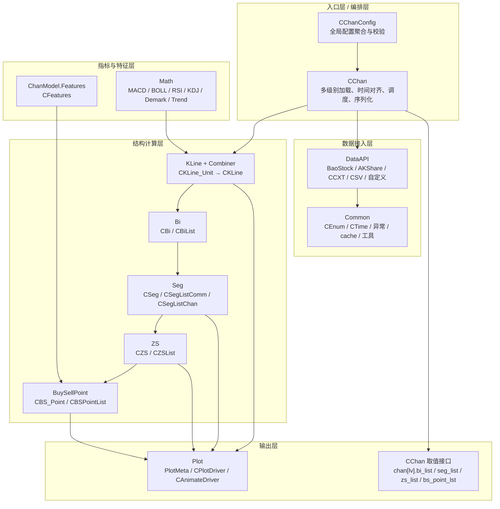
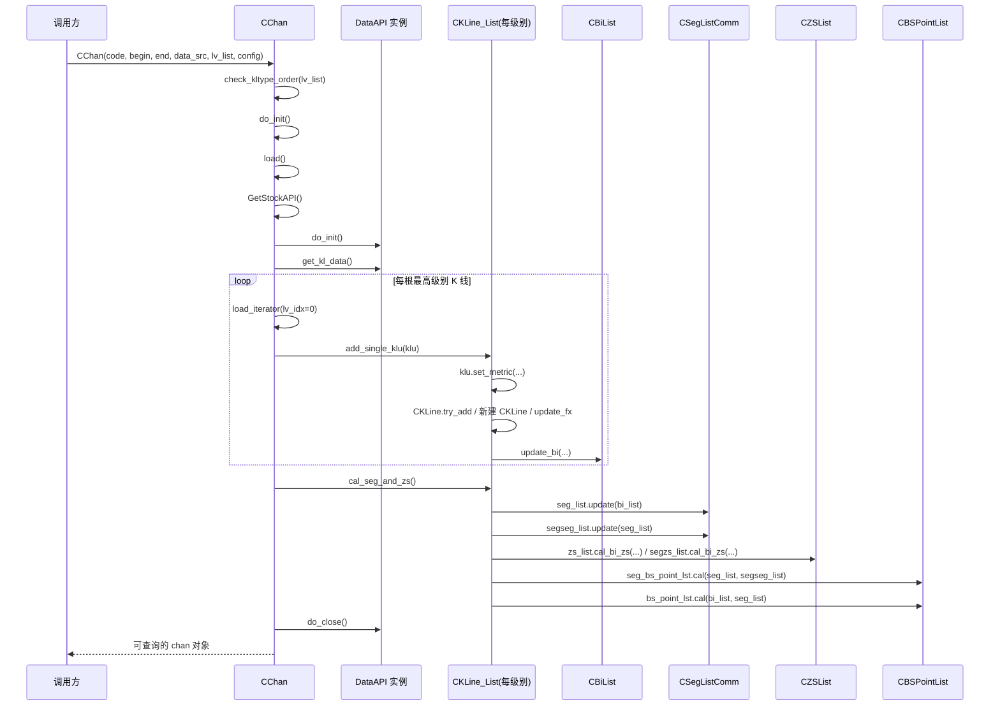
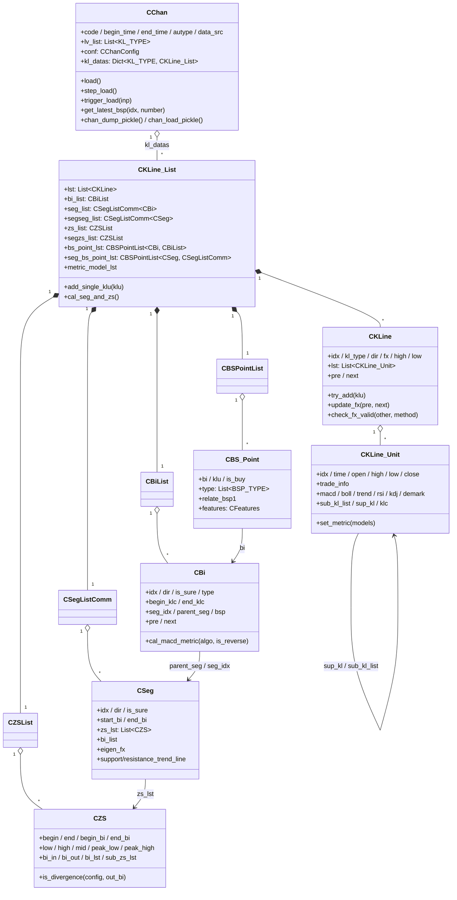

# 01 · 架构总览

## 1. 分层视图

整个项目可以看作一台「K 线 → 缠论结构」的流水线，自上而下分为 5 层：

要点：

1. **只有 `CChan` 一个编排者**。它持有「级别 → `CKLine_List`」的字典，任何元素都挂在对应级别的 `CKLine_List` 上。
2. **结构计算是单向递归推进的**：K线 → 笔 → 线段 → 中枢 → 买卖点。每一层只依赖下层产物，不反向依赖。
3. **`Common` 是全局底座**，几乎被所有模块引用；`Math` 依赖 `CKLine_Unit` 的字段但不反向被其依赖（指标结果写回 klu）。

---

## 2. 一次「静态计算」的完整调用链

以 `CChan(...)`（`trigger_step=False`）为例，构造函数在完成初始化后会**立刻一次性跑完全部计算**：

对应源码：

| 步骤 | 位置 |
| --- | --- |
| 级别顺序校验 | [func_util.check_kltype_order](file:///workspace/Common/func_util.py#L12-L16) |
| 构造与立即计算 | [CChan.__init__](file:///workspace/Chan.py#L20-L53) |
| 创建各级别容器 | [CChan.do_init](file:///workspace/Chan.py#L85-L88) |
| 数据源选择 | [CChan.GetStockAPI](file:///workspace/Chan.py#L171-L194) |
| 主加载流程 | [CChan.load](file:///workspace/Chan.py#L196-L214) |
| 多级别递归 + 时间对齐 | [CChan.load_iterator](file:///workspace/Chan.py#L238-L271) |
| 单根 K 线入列 | [CKLine_List.add_single_klu](file:///workspace/KLine/KLine_List.py#L122-L135) |
| 线段/中枢/买卖点统一入口 | [CKLine_List.cal_seg_and_zs](file:///workspace/KLine/KLine_List.py#L104-L117) |

### 2.1 多级别递归的关键机制

`load_iterator(lv_idx, parent_klu, step)` 是一个递归生成器，行为等价于「**按父级别 K 线切分次级别 K 线**」：

- 从当前级别取一根 klu；
- 若它的时间 **超过** 当前父 klu 的结束时间，就把这根 klu 放进 `klu_cache[lv_idx]` 并退出本轮，等父级别推进后再处理（[Chan.py#L258-L260](file:///workspace/Chan.py#L258-L260)）；
- 否则把它加入本级 `CKLine_List`，然后**递归调用下一级别**，把下级别中落在它时间范围内的 klu 全部消费掉；
- 递归返回后做 `check_kl_align` 校验（次级别是否为空），时间不一致则计入 `kl_inconsistent_detail`。

因此：

- `lv_list[0]` 是「驱动级别」，最高级别每前进一根，次级别被消费一组；
- 次级别数据可以一次喂很多，框架会自己按父级别时间截断（`klu_cache` 就是为此存在）；
- `parent_klu.add_children(kline_unit)` / `kline_unit.set_parent(parent_klu)` 建立了**跨级别引用**（`sub_kl_list` / `sup_kl`），供区间套、绘图下钻使用。

### 2.2 校验点

| 校验 | 触发条件 | 代码 |
| --- | --- | --- |
| K 线时间单调递增 | 每次取新 klu | [Chan.py#L252-L254](file:///workspace/Chan.py#L252-L254) |
| 父子级别日期一致 | `kl_data_check` 且两级都 ≤ 日线 | [check_kl_consitent](file:///workspace/Chan.py#L273-L281) |
| 次级别 K 线缺失 | `kl_data_check` 且 `sub_kl_list` 为空 | [check_kl_align](file:///workspace/Chan.py#L283-L289) |
| 次级别数据整体获取失败 | `auto_skip_illegal_sub_lv=True` | [init_lv_klu_iter](file:///workspace/Chan.py#L153-L169) |
| 最高级别无任何数据 | 加载结束 | [Chan.py#L213-L214](file:///workspace/Chan.py#L213-L214) |

---

## 3. 核心对象关系

> 注意两个「泛型复用」：`CSeg` 的 `start_bi/end_bi` 在 `seg_list` 里是 `CBi`，在 `segseg_list` 里是 `CSeg`；`CBSPointList` 同样分别以 `CBiList` 与 `CSegListComm` 为上下文。这就是「线段的分段」「线段买卖点」几乎零成本复用的原因。

---

## 4. 模块依赖矩阵

`←` 表示「依赖」。列出主要依赖，省略对 `Common` 的普遍依赖。

| 模块 | 依赖 | 说明 |
| --- | --- | --- |
| `Common` | 无 | 最底层；`CEnum` 定义所有枚举 |
| `Math` | `Common` | 纯计算，不 import KLine（避免环） |
| `KLine` | `Combiner`、`Math`、`Bi`、`Seg`、`ZS`、`BuySellPoint`、`ChanConfig` | 聚合层，`CKLine_List` 组装所有子管理器 |
| `Combiner` | `Common`、`KLine.KLine_Unit`（函数内 import） | 通用合并器 |
| `Bi` | `Common`、`KLine` | 笔构造依赖 `CKLine` |
| `Seg` | `Bi`、`Combiner`、`Math.TrendLine` | 特征序列复用合并器 |
| `ZS` | `Bi`、`Seg`、`BuySellPoint.BSPointConfig` | 只用 `CPointConfig` 类型做背驰配置 |
| `BuySellPoint` | `Bi`、`Seg`、`ZS`、`ChanModel.Features` | 买卖点判定 |
| `ChanModel` | 无（纯容器） | `CFeatures` |
| `DataAPI` | `KLine.KLine_Unit`、`Common` | 产出 klu |
| `Plot` | `Chan`、`Math.Demark`、各元素类 | 只读消费 |
| `Chan` | 上述全部 | 编排 |

### 4.1 循环依赖如何被打断

源码里能看到大量「函数内 import」，这不是随手写的，而是刻意为之：

- [KLine_Unit.__init__](file:///workspace/KLine/KLine_Unit.py#L36-L37)：`from KLine.KLine import CKLine` 写在方法内，因为 `CKLine` 反过来要继承 `CKLine_Combiner[CKLine_Unit]`；
- [CBi.__init__](file:///workspace/Bi/Bi.py#L26-L30)：`CSeg`、`CBS_Point` 只在类型标注处用到，放在方法内 import；
- [CCombine_Item.__init__](file:///workspace/Combiner/Combine_Item.py#L5-L8)：合并器需要同时适配 `CBi/CSeg/CKLine_Unit`，也只能延迟 import；
- [KLine_List.get_seglist_instance](file:///workspace/KLine/KLine_List.py#L19-L32)：按 `seg_algo` 延迟选择线段算法实现。

理解这一点，才能在扩展时避免踩 import cycle。

---

## 5. 两种计算模式

| | 静态模式（默认） | 增量/回放模式 |
| --- | --- | --- |
| 开关 | `trigger_step=False` | `CChanConfig({"trigger_step": True})` |
| 构造时是否计算 | 立即跑完 | **不做任何计算** |
| 驱动方式 | `CChan.__init__` 内部 `for _ in self.load()` | `chan.step_load()` 或 `chan.trigger_load(...)` |
| 每次新增 K 线后 | — | 只重算尾部「不确定」部分，然后 `cal_seg_and_zs()` |
| 适用 | 一次性分析、离线选股 | 回测、实盘、逐帧动画 |

两种模式共享同一套 `load_iterator`，区别只在于：

- `step_load()` 断言 `trigger_step`，先 `do_init()` 清空，再 `load(step=True)`，并用 `skip_step` 跳过前 N 帧（[Chan.py#L120-L130](file:///workspace/Chan.py#L120-L130)）；
- `trigger_load(inp)` 允许外部直接喂 `Dict[KL_TYPE, List[CKLine_Unit]]`，见 [Chan.py#L132-L151](file:///workspace/Chan.py#L132-L151)；
- `CKLine_List.step_calculation = config.trigger_step`，决定每根 K 线后是否立刻 `cal_seg_and_zs()`（[KLine_List.py#L52](file:///workspace/KLine/KLine_List.py#L52)、[#L132-L135](file:///workspace/KLine/KLine_List.py#L132-L135)）。

### 5.1 `is_sure` 语义（贯穿全项目的核心约定）

- `is_sure=False` 的元素**只会出现在序列两端**（因为中间部分一旦确认就不会再变）；
- 尾部不确定的笔 / 线段 / 中枢 / 买卖点会随着新 K 线**被修正甚至消失**，这就是 quick_guide 里「信号为什么会消失」的根因；
- 画图中实线 = 确定，虚线 = 不确定（`PlotMeta` 会保留 `is_sure` 字段）。

对应实现：笔的虚笔 [try_add_virtual_bi](file:///workspace/Bi/BiList.py#L120-L141)、线段的虚段 [collect_left_seg](file:///workspace/Seg/SegListComm.py#L112-L119)、中枢的 `free_item_lst` 观察区 [ZSList.py#L38-L50](file:///workspace/ZS/ZSList.py#L38-L50)、买卖点的 `last_sure_pos` 回滚 [BSPointList.py#L44-L60](file:///workspace/BuySellPoint/BSPointList.py#L44-L60)。

---

## 6. 关键设计模式速查

| 模式 | 体现 | 收益 |
| --- | --- | --- |
| 模板方法 | `CSegListComm` 定义 `add_new_seg/collect_left_seg`，子类只实现 `update()` | 三种划段算法共用骨架 |
| 泛型参数化 | `CKLine_Combiner[T]`、`CSeg[LINE_TYPE]`、`CBSPointList[LINE_TYPE, LINE_LIST_TYPE]` | 同一份逻辑服务「笔」与「线段」 |
| 适配器 | `CCombine_Item` 把 `CBi/CSeg/CKLine_Unit` 归一成 `high/low/time` | 合并器不感知具体元素 |
| 装饰器（描述符） | `@make_cache`（`make_cache` 类） | 热点取值函数按实例缓存，`clean_cache()` 精确失效 |
| 策略/工厂 | `CChan.GetStockAPI()`、`get_seglist_instance()`、`CChanConfig.GetMetricModel()` | 数据源、线段算法、指标可插拔 |
| 一次写回 | `CKLine_Unit.set_metric()` 把指标结果写回 klu | 后续所有层直接读 `klu.macd` 等，无重复计算 |

`make_cache` 的实现细节值得单独记住：它要求被装饰方法的签名是 `(self)` 且**无其他参数**，缓存存在实例的 `_memoize_cache` 字典里，key 是函数对象字符串（[Common/cache.py](file:///workspace/Common/cache.py#L1-L34)）。因此元素一旦被修改（`try_add`、`update_new_end`、`set_pre/set_next`），必须调用 `clean_cache()`，否则会读到旧值——这是阅读源码时高频出现的 `self.clean_cache()` 调用的原因。

---

## 7. 阅读建议

- **只做策略、不打算改算法**：读本篇 + [07-配置体系](07-配置体系.md) + [10-增量计算与策略开发](10-增量计算与策略开发.md) 即可。
- **要接自己的数据源**：读 [08-数据接入与指标](08-数据接入与指标.md)。
- **要改笔/线段**：按 [02](02-K线与合并.md) → [03](03-笔-Bi.md) → [04](04-线段-Seg.md) 顺序读，线段是全项目最绕的部分。
- **要改买卖点**：读 [05](05-中枢-ZS.md) → [06](06-买卖点-BSPoint.md)。
