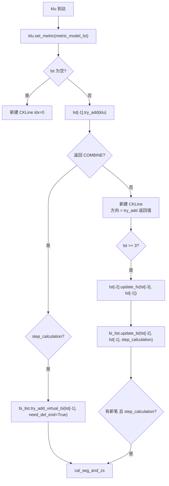

# 02 · K 线与合并

数据底座：时间 `CTime`、单根 K 线 `CKLine_Unit`、合并器 `CKLine_Combiner`、合并 K 线 `CKLine`、级别容器 `CKLine_List`。

---

## 1. 时间对象 `CTime`

源码：[Common/CTime.py](file:///workspace/Common/CTime.py#L1-L44)

```python
CTime(year, month, day, hour, minute, second=0, auto=True)
```

| 成员 | 说明 |
| --- | --- |
| `year/month/day/hour/minute/second` | 时间分量 |
| `auto` | 「对天的理解」开关，默认 `True` |
| `ts` | 构造时计算的时间戳，所有比较基于它 |

### 1.1 `auto` 的作用（高频踩坑点）

当 `hour == 0 and minute == 0 and auto == True` 时，时间戳按**当天 23:59** 计算（[CTime.set_timestamp](file:///workspace/Common/CTime.py#L33-L38)）：

- 日线通常没有小时信息（0:00），于是被当作「当天结束」；
- 这样「日线 2024/01/01」大于「2024/01/01 10:30 的 60 分钟线」，能正确挂到父级别下；
- 数字货币等分钟级数据恰好也是 0:00 时会被误判，此时数据源应传 `auto=False`（`CCXT` 就是这么做的）。

### 1.2 只实现了 `>` 和 `>=`

`CTime` **没有** `__lt__`，只有 `__gt__` / `__ge__`（[#L40-L44](file:///workspace/Common/CTime.py#L40-L44)）。框架内所有比较都写成 `klu.time > last` 形式；自己扩展时不要直接 `t1 < t2`。

`str(time)` 输出 `YYYY/MM/DD` 或 `YYYY/MM/DD HH:MM`，画图刻度与 marker 都用这个格式。

---

## 2. 单根 K 线 `CKLine_Unit`

源码：[KLine/KLine_Unit.py](file:///workspace/KLine/KLine_Unit.py#L17-L154)

### 2.1 构造

```python
CKLine_Unit(kl_dict, autofix=False)
```

`kl_dict` 的键来自 [DATA_FIELD](file:///workspace/Common/CEnum.py#L127-L138)：

| 键 | 必填 | 说明 |
| --- | --- | --- |
| `FIELD_TIME` | ✅ | 必须是 `CTime` |
| `FIELD_OPEN / FIELD_CLOSE / FIELD_HIGH / FIELD_LOW` | ✅ | float |
| `FIELD_VOLUME / FIELD_TURNOVER / FIELD_TURNRATE` | ❌ | 进 `CTradeInfo` |

构造时调用 `check(autofix)`：若 `low` 不是四价最小或 `high` 不是最大，`autofix=False` 抛 `KL_DATA_INVALID`，`True` 则自动修正（[check](file:///workspace/KLine/KLine_Unit.py#L92-L102)）。

### 2.2 关键成员

| 成员 | 类型 | 说明 |
| --- | --- | --- |
| `idx` | int | 本级别序号，由 `CChan.try_set_klu_idx` 统一编排；创建时为 -1 |
| `kl_type` | `KL_TYPE` | 级别，由 `CChan.load_stock_data` 赋值 |
| `time` | `CTime` | 时间 |
| `open/high/low/close` | float | 四价 |
| `trade_info` | `CTradeInfo` | 量/额/换手率，缺失为 `None` |
| `macd` | `CMACD_item` | 由 `set_metric` 写入 |
| `boll` | `BOLL_Metric` | 同上 |
| `trend` | `Dict[TREND_TYPE, Dict[int, float]]` | 键为周期 T |
| `rsi` / `kdj` | float / `KDJ_Item` | 按需写入 |
| `demark` | `CDemarkIndex` | Demark 序列 |
| `klc` | `CKLine` | 所属合并 K 线（私有属性 + property） |
| `sub_kl_list` / `sup_kl` | List / `CKLine_Unit` | 次级别 K 线 / 父级别 K 线 |
| `pre` / `next` | `CKLine_Unit` | 本级别前后 K 线 |
| `limit_flag` | int | 0 普通 / 1 涨停 / -1 跌停（预留） |

### 2.3 指标写回 `set_metric`

```python
klu.set_metric(metric_model_lst)
```

按 `isinstance` 分派（[#L119-L134](file:///workspace/KLine/KLine_Unit.py#L119-L134)）：MACD → `macd`，`CTrendModel` → `trend[type][T]`，BOLL → `boll`，Demark → `demark`，RSI/KDJ → `rsi`/`kdj`。这是**新增指标的唯一写入口**。

### 2.4 其他工具方法

- `get_children()`：迭代 `sub_kl_list`；
- `include_sub_lv_time(t)`：递归判断自身或任意次级别是否包含某时间（区间套/绘图定位）；
- `set_pre_klu(pre)`：维护双向链表 `pre/next`；
- `get_parent_klc()`：`sup_kl.klc`。

### 2.5 `__deepcopy__` 的特殊处理

[#L49-L72](file:///workspace/KLine/KLine_Unit.py#L49-L72) 不走默认深拷贝，而是重新构造 `CKLine_Unit`，再逐项拷贝 `demark/trend/macd/boll/rsi/kdj/limit_flag/idx`。原因：

- 避免把 `klc`、`sup_kl`、`sub_kl_list`、`pre/next` 这些图状引用一起递归拷贝，导致膨胀或循环；
- `CChan.__deepcopy__` 会随后手工重建这些指针（见 [10-增量计算与策略开发](10-增量计算与策略开发.md#5-快照deepcopy-与-pickle)）。

---

## 3. 元素适配器 `CCombine_Item`

源码：[Combiner/Combine_Item.py](file:///workspace/Combiner/Combine_Item.py#L4-L25)

把三种元素统一抽取成 `(time_begin, time_end, high, low)`：

| 输入类型 | `time_begin` | `time_end` | `high/low` |
| --- | --- | --- | --- |
| `CKLine_Unit` | `time` | `time` | `high/low` |
| `CBi` | `begin_klc.idx` | `end_klc.idx` | `_high()/_low()` |
| `CSeg` | `start_bi.begin_klc.idx` | `end_bi.end_klc.idx` | `_high()/_low()` |

这是「特征序列把笔当 K 线」的关键：x 轴用 `idx`（K 线序号）而非时间，保证不同粒度的元素可以放在同一坐标系比较。

---

## 4. 合并器 `CKLine_Combiner`

源码：[Combiner/KLine_Combiner.py](file:///workspace/Combiner/KLine_Combiner.py#L13-L171)

泛型基类，`CKLine`（元素是 `CKLine_Unit`）与 `CEigen`（元素是 `CBi`）都继承它。

### 4.1 成员

| 成员 | 说明 |
| --- | --- |
| `__time_begin/__time_end` | 合并区间，`try_add` 更新 `time_end` |
| `__high/__low` | 合并后的高低点 |
| `__lst` | 被合并的原始元素列表 |
| `__dir` | `KLINE_DIR.UP / DOWN`（`COMBINE`/`INCLUDED` 只是 `test_combine` 返回值） |
| `__fx` | `FX_TYPE.UNKNOWN / TOP / BOTTOM` |
| `__pre/__next` | 前后合并元素 |
| `_memoize_cache` | 供 `@make_cache` 使用 |

`pre` 对首元素会断言失败（源码里 `assert self.__pre is not None` 后返回），因此大量代码先判空。

### 4.2 包含关系判定 `test_combine`

```python
dir = combiner.test_combine(item, exclude_included=False, allow_top_equal=None)
```

四种结果（[#L64-L78](file:///workspace/Combiner/KLine_Combiner.py#L64-L78)）：

| 条件 | 返回 | 含义 |
| --- | --- | --- |
| 新元素被当前完全包含 | `COMBINE` | 合并 |
| 当前被新元素完全包含 | `COMBINE`（或 `INCLUDED`） | `exclude_included=True` 时返回 `INCLUDED` 表示不合并 |
| 两者都下移 | `DOWN` | 不合并，向下 |
| 两者都上移 | `UP` | 不合并，向上 |

`allow_top_equal` 处理特征序列边界：

- `1`：被包含且顶相等、底更高 → 返回 `DOWN`；
- `-1`：被包含且底相等、顶更低 → 返回 `UP`；
- `None`：普通模式。

### 4.3 合并规则 `try_add`

[#L84-L107](file:///workspace/Combiner/KLine_Combiner.py#L84-L107)：

1. `test_combine` 判定方向；
2. `COMBINE` 时把元素追加进 `lst`，并把 klu 的 `klc` 指回自己（`skip_update_input=True` 时跳过，供深拷贝重建）；
3. **按当前方向取极值**：`UP` 时 `high=max, low=max`；`DOWN` 时 `high=min, low=min`；对一字 K 线（`high==low`）特判；
4. 更新 `time_end`，**`clean_cache()`**；
5. 返回方向给 `CKLine_List`，用于决定是否新建 `CKLine` 及其方向。

### 4.4 分型判定 `update_fx`

[#L127-L145](file:///workspace/Combiner/KLine_Combiner.py#L127-L145)：

- 普通模式：当前高（低）点同时高于（低于）前、后两根 → `TOP` / `BOTTOM`；
- `exclude_included=True`（特征序列）时条件放宽，并可结合 `allow_top_equal`；
- 顺带维护 `pre/next` 并清缓存。

`CKLine_List.add_single_klu` 在新建第 3 根及以后的 `CKLine` 时，回头对「倒数第二根」调用 `update_fx(lst[-3], lst[-1])`——**分型要等右侧一根出现才能确认**，这天然导致分型/笔有一根 K 线的滞后。

### 4.5 极值定位 `get_peak_klu`

```python
klc.get_peak_klu(is_high)  # 该合并K线中 high 最大 / low 最小的原始元素
```

**从后往前**找第一个等于极值的元素，并用 `@make_cache` 缓存（[#L113-L125](file:///workspace/Combiner/KLine_Combiner.py#L113-L125)）。从后往前是刻意的：笔端点取极值**最后一次**出现的位置。

---

## 5. 合并 K 线 `CKLine`

源码：[KLine/KLine.py](file:///workspace/KLine/KLine.py#L9-L97)

在基类之上增加：

| 成员/方法 | 说明 |
| --- | --- |
| `idx` | 合并 K 线序号 |
| `kl_type` | 级别 |
| `GetSubKLC()` | 获取次级别 `CKLine`（相邻父 KLC 可能共享子 KLC，有去重） |
| `get_klu_max_high()/get_klu_min_low()` | 内部原始 K 线最大高/最小低 |
| `has_gap_with_next()` | 与下一根是否跳空（相同价位算重叠） |
| `check_fx_valid(item2, method, for_virtual=False)` | 分型成立性检查，笔的核心判定 |

### 5.1 `check_fx_valid` 的四种模式

对应 `CChanConfig.bi_fx_check`（[FX_CHECK_METHOD](file:///workspace/Common/CEnum.py#L100-L104)），以「顶分型 → 底分型」为例（[KLine.py#L45-L97](file:///workspace/KLine/KLine.py#L45-L97)）：

| 模式 | 比较方式 | 严格度 |
| --- | --- | --- |
| `STRICT`（默认） | 顶分型高 > 底分型三元素最高；底分型低 < 顶分型三元素最低 | 最严 |
| `TOTALLY` | 顶分型 `low > item2_high`（整体不接触） | 最严 |
| `LOSS` | 只比较顶/底分型自身 | 较松 |
| `HALF` | 顶分型只比底分型「前两元素」，底分型只比顶分型「后两元素」 | 较松 |

`for_virtual=True`（虚笔）时右端元素可能缺失，只取 `pre` 侧，并额外要求方向匹配（`item2.dir` 必须反向）。

---

## 6. 级别容器 `CKLine_List`

源码：[KLine/KLine_List.py](file:///workspace/KLine/KLine_List.py#L35-L139)

### 6.1 构造：一个级别一套全套管理器

| 成员 | 类型 | 说明 |
| --- | --- | --- |
| `lst` | `List[CKLine]` | 合并 K 线序列 |
| `bi_list` | `CBiList` | 笔 |
| `seg_list` | `CSegListComm[CBi]` | 线段 |
| `segseg_list` | `CSegListComm[CSeg]` | 线段的分段 |
| `zs_list` | `CZSList` | 笔中枢 |
| `segzs_list` | `CZSList` | 线段中枢 |
| `bs_point_lst` | `CBSPointList[CBi, CBiList]` | 笔买卖点 |
| `seg_bs_point_lst` | `CBSPointList[CSeg, CSegListComm]` | 线段买卖点 |
| `metric_model_lst` | list | `conf.GetMetricModel()` 生成，各级别独立 |
| `step_calculation` | bool | 等于 `config.trigger_step` |
| `last_sure_seg_start_bi_idx` / `last_sure_segseg_start_bi_idx` | int | 增量游标 |

线段算法由 `get_seglist_instance` 工厂化选择（[#L19-L32](file:///workspace/KLine/KLine_List.py#L19-L32)）：`chan → CSegListChan`，`1+1 → CSegListDYH`，`break → CSegListDef`。后两者在代码中打印 deprecated 提示。

### 6.2 单根 K 线入列 `add_single_klu`

整条流水线的「心跳」（[#L122-L135](file:///workspace/KLine/KLine_List.py#L122-L135)）：



要点：

- **指标先于结构计算**，所以背驰/买卖点可以安全读 `klu.macd`；
- 合并/不合并都会影响尾部分型，`COMBINE` 时增量模式要尝试更新虚笔；
- 非增量模式 `update_bi` 传 `cal_virtual=False`，虚笔在 `cal_seg_and_zs` 中统一补。

### 6.3 统一计算入口 `cal_seg_and_zs`

[#L104-L117](file:///workspace/KLine/KLine_List.py#L104-L117) 是总调度：

```python
if not step_calculation:
    bi_list.try_add_virtual_bi(lst[-1])
last_sure_seg_start_bi_idx = cal_seg(bi_list, seg_list, ...)
zs_list.cal_bi_zs(bi_list, seg_list)
update_zs_in_seg(bi_list, seg_list, zs_list)
last_sure_segseg_start_bi_idx = cal_seg(seg_list, segseg_list, ...)
segzs_list.cal_bi_zs(seg_list, segseg_list)
update_zs_in_seg(seg_list, segseg_list, segzs_list)
seg_bs_point_lst.cal(seg_list, segseg_list)
bs_point_lst.cal(bi_list, seg_list)
```

顺序不可乱：中枢依赖线段的 `seg_idx` 归属，买卖点依赖中枢的 `bi_in/bi_out` 与背驰。

### 6.4 两个辅助函数

**`cal_seg(bi_list, seg_list, last_sure_seg_start_bi_idx)`**（[#L142-L174](file:///workspace/KLine/KLine_List.py#L142-L174)）

- 调用 `seg_list.update(bi_list)` 生成/修正线段；
- 从最后一笔**倒序**遍历，回填每笔的 `seg_idx`；
- 遇到「已确定线段」的起始笔即停止，返回新的增量游标。

**`update_zs_in_seg(bi_list, seg_list, zs_list)`**（[#L177-L204](file:///workspace/KLine/KLine_List.py#L177-L204)）

- 从尾部往前处理**未确定**线段（遇到 `ele_inside_is_sure` 即停）；
- 对每个线段清空并重新挂接中枢：`zs.is_inside(seg)` 时 `seg.add_zs(zs)`；
- 给中枢补 `bi_in`（前一笔）、`bi_out`（后一笔）、`bi_lst`（内部笔）；
- 连续 3 个确定线段后，把更早线段标记 `ele_inside_is_sure=True`，后续不再重算。

---

## 7. 交易信息 `CTradeInfo`

源码：[KLine/TradeInfo.py](file:///workspace/KLine/TradeInfo.py#L6-L13)：从输入字典抽取 `volume / turnover / turnover_rate`，缺省 `None`。它支撑 `CBi.Cal_MACD_trade_metric`，是 `macd_algo` 能取 `volumn/amount/turnrate_avg` 的基础。

---

## 8. 本篇小结

- `CTime.auto` 决定日线与分钟线的父子归属，是时间对齐的第一块基石；
- `CKLine_Unit` 是唯一数据载体，指标「一次写回」；
- `CKLine_Combiner` 用 `test_combine + try_add + update_fx` 完成包含处理与分型，并被特征序列复用；
- `CKLine_List` 是级别内的总装线：指标 → 合并 → 笔 → （触发时）线段/中枢/买卖点。

下一步：[03-笔-Bi](03-笔-Bi.md)。
