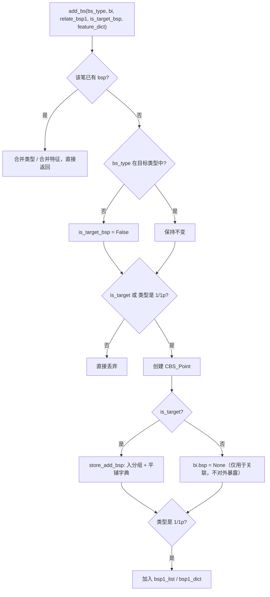

# 06 · 买卖点（BuySellPoint / BSP）

买卖点是框架的最终产出：**形态学**意义上的 1/2/3 类买卖点（事后看必然成立的那一类）。本仓库**不包含**动力学买卖点 `cbsp`（自定义策略），那是完整版的能力。

源码：

- [BuySellPoint/BS_Point.py](file:///workspace/BuySellPoint/BS_Point.py#L11-L46)
- [BuySellPoint/BSPointList.py](file:///workspace/BuySellPoint/BSPointList.py#L18-L439)
- [BuySellPoint/BSPointConfig.py](file:///workspace/BuySellPoint/BSPointConfig.py#L7-L81)

---

## 1. 六种买卖点类型

`BSP_TYPE`（[Common/CEnum.py#L66-L75](file:///workspace/Common/CEnum.py#L66-L75)）：

| 枚举 | `value` | 含义 | 本仓库判定函数 |
| --- | --- | --- | --- |
| `T1` | `1` | 一类买卖点（趋势背驰） | `treat_bsp1` |
| `T1P` | `1p` | 盘整背驰一类买卖点 | `treat_pz_bsp1` |
| `T2` | `2` | 二类买卖点（一类后第一次回抽不创新极值） | `treat_bsp2` |
| `T2S` | `2s` | 类二买卖点（二类之后的多次回抽） | `treat_bsp2s` |
| `T3A` | `3a` | 三类买卖点，中枢在 1 类**之后**（after） | `treat_bsp3_after` |
| `T3B` | `3b` | 三类买卖点，中枢在 1 类**之前**（before） | `treat_bsp3_before` |

`BSP_TYPE.main_type()` 取 `value[0]`，用于归类到 `1/2/3`。

**买卖方向**：`is_buy = bi.is_down()`（[BSPointList.add_bs](file:///workspace/BuySellPoint/BSPointList.py#L132)）——买点永远出现在**下降笔的终点**，卖点出现在上升笔终点。

---

## 2. 买卖点对象 `CBS_Point`

```python
CBS_Point(bi, is_buy, bs_type, relate_bsp1, feature_dict=None)
```

[BS_Point.py#L11-L46](file:///workspace/BuySellPoint/BS_Point.py#L11-L46)

| 成员 | 说明 |
| --- | --- |
| `bi` | 所属笔（或线段） |
| `klu` | `bi.get_end_klu()`，买卖点所在 K 线 |
| `is_buy` | `True` 买点 / `False` 卖点 |
| `type: List[BSP_TYPE]` | **类型是列表**：同一个位置可能同时是 2 类和 3 类 |
| `relate_bsp1` | 关联的一类买卖点（用于 2/3 类的「必须跟在 1 类后面」约束） |
| `features: CFeatures` | 特征容器，供机器学习使用 |
| `is_segbsp` | 恒为 `False`（线段买卖点由绘图侧用 `※` 标记，见 `PlotMeta`） |

构造时会：

1. 反向写回 `bi.bsp = self`（所以「某笔尾部是不是买卖点」可以直接查 `bi.bsp`）；
2. 写入通用特征 `bsp_bi_amp = bi.amp()`（[init_common_feature](file:///workspace/BuySellPoint/BS_Point.py#L42-L46)）。

`add_another_bsp_prop` 在「同一笔上出现新的买卖点类型」时调用：追加类型，并校验两次传入的 `relate_bsp1` 指向同一根 K 线（[#L32-L37](file:///workspace/BuySellPoint/BS_Point.py#L32-L37)）。

---

## 3. 存储结构 `CBSPointList`

### 3.1 四个容器

| 容器 | 类型 | 用途 |
| --- | --- | --- |
| `bsp_store_dict` | `Dict[BSP_TYPE, Tuple[List, List]]` | 按类型、按买卖方向分组存放；下标 `True` 买 / `False` 卖 |
| `bsp_store_flat_dict` | `Dict[int, CBS_Point]` | 按 `bi.idx` 索引，用于「同一笔去重合并类型」与 O(1) 查询 |
| `bsp1_list` | `List[CBS_Point]` | 所有一类买卖点（含未纳入目标类型的），供 2/3 类回溯 |
| `bsp1_dict` | `Dict[int, CBS_Point]` | `bsp1_list` 的按笔索引版本 |

`len(bsp_point_list)` 返回的是 `bsp_store_flat_dict` 的长度，即**去重后的买卖点个数**。

### 3.2 新增 `add_bs`

[#L124-L157](file:///workspace/BuySellPoint/BSPointList.py#L124-L157)：



设计意图：**即便用户没把 `1` 配进 `bs_type`，1 类买卖点也会被内部创建**，因为 2/3 类需要 `relate_bsp1` 做「是否跟在 1 类后面」的判断；只是不进入对外结果。

### 3.3 主流程 `cal`

[#L100-L107](file:///workspace/BuySellPoint/BSPointList.py#L100-L107)：

```python
clear_store_end()      # 回滚不确定尾部
clear_bsp1_end()
cal_seg_bs1point(...)  # 1 / 1p
cal_seg_bs2point(...)  # 2 / 2s
cal_seg_bs3point(...)  # 3a / 3b
update_last_pos(...)   # 记录安全位置
```

所有判定都以**线段**为遍历单位，从 `last_sure_seg_idx` 开始，只算「尾端可能变化」的线段：

```python
def update_last_pos(seg_list):
    last_sure_pos = 最后一个确定线段的 end_bi.get_begin_klu().idx
    last_sure_seg_idx = 该线段 idx
def seg_need_cal(seg):
    return seg.end_bi.get_end_klu().idx > last_sure_pos
```

`clear_store_end` / `clear_bsp1_end`（[#L44-L60](file:///workspace/BuySellPoint/BSPointList.py#L44-L60)）会把「终点 K 线 idx 大于安全位置」的买卖点全部删除，并把对应笔的 `bi.bsp` 置空——这就是**买卖点会消失**的代码位置。

### 3.4 查询接口

| 方法 | 说明 |
| --- | --- |
| `bsp_iter()` | 按类型分组顺序迭代（类型内先买后卖），**非全局按时间排序** |
| `bsp_iter_v2()` | 多路归并，按 `bi.idx` **从新到旧**输出 |
| `getSortedBspList()` | 全量按 `bi.idx` 升序 |
| `get_latest_bsp(number)` | 取最新 N 个；`number=0` 表示全部（[#L402-L411](file:///workspace/BuySellPoint/BSPointList.py#L402-L411)） |

`CChan.get_latest_bsp(idx, number)` 就是对它的封装（[Chan.py#L306-L311](file:///workspace/Chan.py#L306-L311)）。

---

## 4. 一类买卖点（1 / 1p）

### 4.1 入口判定 `cal_single_bs1point`

[#L165-L175](file:///workspace/BuySellPoint/BSPointList.py#L165-L175)：

```python
BSP_CONF = config.GetBSConfig(seg.is_down())   # 下降段 → 用「买点」配置
zs_cnt = seg.get_multi_bi_zs_cnt() if bsp1_only_multibi_zs else len(seg.zs_lst)
is_target_bsp = (min_zs_cnt <= 0 or zs_cnt >= min_zs_cnt)
if seg.zs_lst 非空 and 最后一个中枢不是一笔中枢
   and (中枢出笔已到段尾 或 中枢最后一笔已到段尾)
   and (段尾笔 - 进中枢笔) > 2:
        treat_bsp1        # 趋势背驰
else:
        treat_pz_bsp1     # 盘整背驰
```

- `bsp1_only_multibi_zs=True`（默认）时，「中枢数」只数**至少 3 笔的中枢**，避免 `one_bi_zs` 把一类买卖点门槛降低；
- `min_zs_cnt` 控制「至少几个中枢」；`min_zs_cnt<=0` 表示不做中枢数量限制。

### 4.2 趋势背驰 `treat_bsp1`

[#L177-L189](file:///workspace/BuySellPoint/BSPointList.py#L177-L189)：

1. `out_bi_is_peak` 检查中枢出笔是否是中枢区间内最极端 → 若 `bs1_peak=True` 且不满足，则不是目标买卖点（仍会创建对象但只用于关联）；
2. `last_zs.is_divergence(BSP_CONF, out_bi=seg.end_bi)` 判断背驰；
3. 写入特征 `divergence_rate`（出/入力度比）与 `zs_cnt`。

### 4.3 盘整背驰 `treat_pz_bsp1`

[#L191-L213](file:///workspace/BuySellPoint/BSPointList.py#L191-L213)：适用于「段尾没有成型中枢或中枢未延伸到段尾」的情况：

1. `last_bi = seg.end_bi`，`pre_bi = bi_list[last_bi.idx - 2]`（同向的前一笔）；
2. 必须同属一个线段（`seg_idx` 相同）、方向与线段一致；
3. 必须**创新低/新高**（下降笔的低点低于 `pre_bi` 的低点）；
4. 比较 `pre_bi`（入）与 `last_bi`（出）的力度，满足 `out <= divergence_rate * in` 即为背驰；
5. 写入特征 `divergence_rate`、`bsp1_bi_amp`。

---

## 5. 二类买卖点（2 / 2s）

### 5.1 二类 `treat_bsp2`

[#L224-L255](file:///workspace/BuySellPoint/BSPointList.py#L224-L255)：

- 以线段尾笔 `bsp1_bi = seg.end_bi` 为一类买卖点位置；
- `break_bi = bi_list[bsp1_bi.idx + 1]`（反向突破笔），`bsp2_bi = bi_list[bsp1_bi.idx + 2]`（回抽笔）；
- `bsp2_follow_1=True`（默认）时，要求该位置确实存在一类买卖点，否则跳过；
- 回撤比例：`retrace_rate = bsp2_bi.amp() / break_bi.amp()`，需 `<= max_bs2_rate`；
- 特征：`bsp2_retrace_rate`、`bsp2_break_bi_amp`、`bsp2_bi_amp`。

只有一条线段时走 `else` 分支：用 `bi_list[0]` 作突破笔、`bi_list[1]` 作回抽笔，配置取 `seg.is_up()` 对应方向。

### 5.2 类二 `treat_bsp2s`

[#L257-L295](file:///workspace/BuySellPoint/BSPointList.py#L257-L295)：从二类买卖点往后**每隔 2 笔**找一个同向回抽笔：

- `bias += 2`，`bias/2` 就是「类二的层级」，受 `max_bsp2s_lv` 限制；
- 跨线段后必须仍在最后一条线段内（或跨越不超过 1 段）；
- 第 1 个候选必须与二类笔有重叠，后续候选必须与「已形成的重叠区间」保持重叠；
- 若候选笔跌破一类买卖点（`bsp2s_break_bsp1`）→ 终止；
- 回撤比例 `abs(候选终点 - 突破笔终点) / 突破笔振幅` 需 `<= max_bs2_rate`；
- 特征：`bsp2s_retrace_rate`、`bsp2s_break_bi_amp`、`bsp2s_bi_amp`、`bsp2s_lv`。

触发条件：只有当「二类不成立」且 `bsp2s_follow_2=False` 时才会继续找类二（[#L251-L255](file:///workspace/BuySellPoint/BSPointList.py#L251-L255)）。

---

## 6. 三类买卖点（3a / 3b）

入口 `cal_seg_bs3point`（[#L297-L321](file:///workspace/BuySellPoint/BSPointList.py#L297-L321)）：

- 确定 `next_seg`（`seg.next`）与 `bsp1_bi`；
- `bsp3_follow_1=True`（默认）时不满足「存在 1 类」直接跳过；
- 同时尝试 `treat_bsp3_after`（3a）与 `treat_bsp3_before`（3b）。

### 6.1 3a：中枢在一类之后

`treat_bsp3_after`（[#L323-L366](file:///workspace/BuySellPoint/BSPointList.py#L323-L366)）：

1. 取 `next_seg` 的第一个**非一笔中枢** `first_zs`；
2. `strict_bsp3=True` 时，要求该中枢的进笔就是一类买卖点之后的第一笔；
3. 只遍历前 `bsp3a_max_zs_cnt`（默认 1）个非一笔中枢；
4. 三类买点笔 = 中枢出笔的下一笔（`bi_list[zs.bi_out.idx + 1]`）；
5. 多重过滤：所属线段、方向、跨段距离、是否回落到中枢内（`bsp3_back2zs`）、是否突破中枢极值（`bsp3_peak`）；
6. 特征：`bsp3_zs_height = (high-low)/low`、`bsp3_bi_amp`。

### 6.2 3b：中枢在一类之前

`treat_bsp3_before`（[#L368-L400](file:///workspace/BuySellPoint/BSPointList.py#L368-L400)）：

1. 取当前段最后一个非一笔中枢 `cmp_zs`；
2. `strict_bsp3=True` 时要求中枢出笔就是一类买卖点笔；
3. 计算候选笔的搜索终点 `cal_bsp3_bi_end_idx(next_seg)`；
4. 从 `bsp1_bi.idx + 2` 开始**隔一笔**遍历（同向笔），找到第一个不回中枢、且方向正确的笔即为 3b，随后 `break`（3b 每段只取一个）。

### 6.3 三个辅助判定

[#L414-L439](file:///workspace/BuySellPoint/BSPointList.py#L414-L439)：

```python
bsp2s_break_bsp1(bsp2s_bi, break_bi)   # 类二笔是否跌破/涨破一类突破笔
bsp3_back2zs(bsp3_bi, zs)              # 三类笔是否重新回到中枢区间
bsp3_break_zspeak(bsp3_bi, zs)         # 三类笔是否突破中枢极值（peak_high/peak_low）
cal_bsp3_bi_end_idx(seg)               # 3b 候选笔的搜索上界
```

---

## 7. 配置 `CBSPointConfig`

### 7.1 结构

```python
CBSPointConfig(b_conf=CPointConfig, s_conf=CPointConfig)
config.GetBSConfig(is_buy)   # 买点用 b_conf，卖点用 s_conf
```

买/卖两份配置完全独立，便于「买点严格、卖点宽松」这类非对称设置。

`CPointConfig` 字段（[BSPointConfig.py#L16-L57](file:///workspace/BuySellPoint/BSPointConfig.py#L16-L57)）：

| 字段 | `CChanConfig` 默认 | 作用 |
| --- | --- | --- |
| `divergence_rate` | `inf` | 背驰比例阈值；`>100` 视为保送 |
| `min_zs_cnt` | `1` | 一类买卖点最少中枢数 |
| `bsp1_only_multibi_zs` | `True` | 统计中枢数时只算「至少 3 笔」的中枢 |
| `max_bs2_rate` | `0.9999` | 二类回撤比例上限 |
| `macd_algo` | `peak` | 力度算法（枚举 `MACD_ALGO`） |
| `bs1_peak` | `True` | 一类买卖点是否必须在中枢极值处 |
| `target_types` | `1,1p,2,2s,3a,3b` | 关注的类型（由 `bs_type` 解析） |
| `bsp2_follow_1` | `True` | 二类是否必须跟在 1 类后 |
| `bsp3_follow_1` | `True` | 三类是否必须跟在 1 类后 |
| `bsp3_peak` | `False` | 三类突破笔是否必须突破中枢极值 |
| `bsp2s_follow_2` | `False` | 类二是否必须跟在二类后 |
| `max_bsp2s_lv` | `None` | 类二最大层级（不限） |
| `strict_bsp3` | `False` | 三类中枢是否必须紧挨 1 类 |
| `bsp3a_max_zs_cnt` | `1` | 3a 最多跨几个中枢 |

### 7.2 线段买卖点的隐式覆盖

[ChanConfig.set_bsp_config](file:///workspace/ChanConfig.py#L105-L159) 里，`seg_bs_point_conf` 复制自同一份参数后，**强制**做了两处修改：

```python
seg_bs_point_conf.b_conf.set("macd_algo", "slope")
seg_bs_point_conf.s_conf.set("macd_algo", "slope")
seg_bs_point_conf.b_conf.set("bsp1_only_multibi_zs", False)
seg_bs_point_conf.s_conf.set("bsp1_only_multibi_zs", False)
```

原因：`CSeg.cal_macd_metric` 只实现 `slope/amp`（见 [04-线段-Seg](04-线段-Seg.md#23-关键方法)），且线段级别通常不希望中枢数量门槛过高。这意味着你无法把线段买卖点的力度算法改成 `peak`。

### 7.3 分级别精调后缀

`CChanConfig` 支持在参数名后加后缀，把配置精确作用到某一侧（[ChanConfig.py#L131-L155](file:///workspace/ChanConfig.py#L131-L155)）：

| 后缀 | 作用对象 | 示例 |
| --- | --- | --- |
| `-buy` | 笔买卖点的**买点** | `min_zs_cnt-buy=2` |
| `-sell` | 笔买卖点的**卖点** | `divergence_rate-sell=0.6` |
| `-segbuy` | 线段买卖点买点 | `max_bs2_rate-segbuy=0.5` |
| `-segsell` | 线段买卖点卖点 | — |
| `-seg` | 线段买卖点买卖两侧 | `bs1_peak-seg=False` |
| 无后缀 | 笔 + 线段，买卖两侧 | `divergence_rate=0.9` |

实现方式是对属性名做 `exec` 赋值（`CPointConfig.set`，[BSPointConfig.py#L76-L81](file:///workspace/BuySellPoint/BSPointConfig.py#L76-L81)），并特殊处理 `macd_algo`（走 `SetMacdAlgo` 枚举映射）。

`bs_type` 的解析在 `parse_target_type`（[#L51-L57](file:///workspace/BuySellPoint/BSPointConfig.py#L51-L57)）：逗号分隔字符串 → 逐项断言合法性 → 映射成 `BSP_TYPE` 列表。

---

## 8. 特征清单（机器学习用）

| 来源 | 特征名 |
| --- | --- |
| 所有买卖点 | `bsp_bi_amp` |
| 1 类 | `divergence_rate`、`zs_cnt` |
| 1p | `divergence_rate`、`bsp1_bi_amp` |
| 2 类 | `bsp2_retrace_rate`、`bsp2_break_bi_amp`、`bsp2_bi_amp` |
| 2s | `bsp2s_retrace_rate`、`bsp2s_break_bi_amp`、`bsp2s_bi_amp`、`bsp2s_lv` |
| 3a / 3b | `bsp3_zs_height`、`bsp3_bi_amp` |

特征容器 `CFeatures` 见 [ChanModel/Features.py](file:///workspace/ChanModel/Features.py#L4-L18)，可以继续 `add_feat` 追加策略特征（`Debug/strategy_demo5.py` 演示了完整流程）。

---

## 9. 本篇小结

- 买点必在下降笔终点，卖点在上升笔终点；
- 一类 = 中枢背驰（趋势）或盘整背驰，门槛由 `min_zs_cnt` / `divergence_rate` / `bs1_peak` 控制；
- 二类 = 一类后回抽不破新极值，`max_bs2_rate` 控制回撤；
- 类二 = 二类之后的多次回抽，受 `max_bsp2s_lv` / `bsp2s_follow_2` 约束；
- 三类 = 离开中枢后回踩不重回中枢，`3a/3b` 区分中枢相对 1 类的位置；
- 买卖点会因尾部结构变化被**回滚删除**，这是「信号消失」的根源。

下一步：[07-配置体系](07-配置体系.md)。
