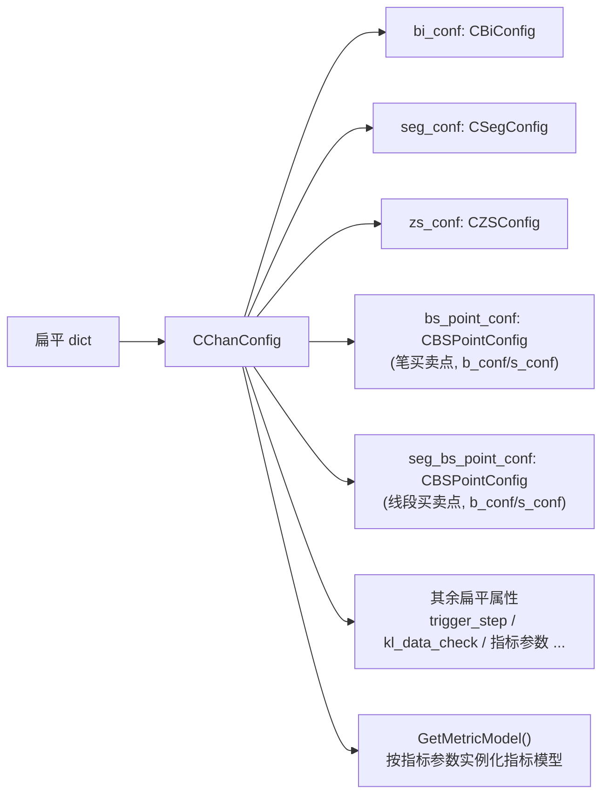

# 07 · 配置体系

所有计算行为都由 `CChanConfig` 一个入口控制。它在构造时把扁平字典**分发给各子模块的配置对象**，并在最后做一次「未知参数检查」。

源码：[ChanConfig.py](file:///workspace/ChanConfig.py#L18-L183)

```python
from ChanConfig import CChanConfig
config = CChanConfig({...})          # 传入扁平字典
CChan(..., config=config)
```

---

## 1. 配置分发结构



- `bi_conf / seg_conf / zs_conf` 直接由对应子配置类构造；
- 买卖点配置通过 `set_bsp_config` 完成，支持后缀精调（见第 4 节）；
- 指标不预实例化，而是在 `GetMetricModel()` 中**每个级别各创建一份新实例**（[#L75-L103](file:///workspace/ChanConfig.py#L75-L103)），保证多级别指标状态互不干扰。

---

## 2. 参数总表（以本仓库源码为准）

### 2.1 笔（→ `CBiConfig`）

| 参数 | 取值 | 默认 | 说明 |
| --- | --- | --- | --- |
| `bi_algo` | `normal` / `fx` | `normal` | `normal` 按缠论笔定义；`fx` 有顶底分型即成笔（跳过跨度检查） |
| `bi_strict` | bool | `True` | 严格笔：分型间至少跨 4 根合并 K 线；`False` 时 3 根 + 原始 K 线 ≥ 3 |
| `bi_fx_check` | `strict` / `totally` / `loss` / `half` | `strict` | 分型成立检查方法，严格度见 [02](02-K线与合并.md#51-check_fx_valid-的四种模式) |
| `gap_as_kl` | bool | `False` | 跳空是否额外计为一根 K 线（影响笔跨度） |
| `bi_end_is_peak` | bool | `True` | 笔终点必须是整笔区间极值 |
| `bi_allow_sub_peak` | bool | `True` | 是否允许次高点成笔（极值替换） |

### 2.2 线段（→ `CSegConfig`）

| 参数 | 取值 | 默认 | 说明 |
| --- | --- | --- | --- |
| `seg_algo` | `chan` / `1+1` / `break` | `chan` | 特征序列 / 都业华1+1 / 线段破坏定义；后两者已标弃用 |
| `left_seg_method` | `peak` / `all` | `peak` | 尾部剩余笔如何成段 |

### 2.3 中枢（→ `CZSConfig`）

| 参数 | 取值 | 默认 | 说明 |
| --- | --- | --- | --- |
| `zs_combine` | bool | `True` | 是否合并相邻重叠中枢 |
| `zs_combine_mode` | `zs` / `peak` | `zs` | 区间重叠 / 整体极值区间重叠 |
| `one_bi_zs` | bool | `False` | 是否生成「一笔中枢」 |
| `zs_algo` | `normal` / `over_seg` / `auto` | `normal` | 段内 / 跨段 / 自动 |

### 2.4 执行与数据校验

| 参数 | 默认 | 说明 |
| --- | --- | --- |
| `trigger_step` | `False` | 逐根回放模式；`True` 时构造 `CChan` **不做任何计算** |
| `skip_step` | `0` | 回放时跳过前 N 帧（`trigger_step=True` 有效） |
| `kl_data_check` | `True` | 是否校验 K 线数据（时间乱序、级别缺失） |
| `max_kl_misalgin_cnt` | `2` | 次级别找不到 K 线的最大容忍条数 |
| `max_kl_inconsistent_cnt` | `5` | 父子级别日期不一致的最大容忍条数 |
| `auto_skip_illegal_sub_lv` | `False` | 次级别数据获取失败时是否自动跳过该级别（指数常无分钟线） |
| `print_warning` | `True` | 是否打印数据不一致警告 |
| `print_err_time` | `True` | 计算异常时是否打印出错 K 线时间 |

### 2.5 指标

| 参数 | 默认 | 说明 |
| --- | --- | --- |
| `mean_metrics` | `[]` | 均线周期列表，如 `[5, 20]` → 写入 `klu.trend[MEAN][5]` |
| `trend_metrics` | `[]` | 上下轨周期列表，如 `[20]` → `trend[MAX][20]` / `trend[MIN][20]` |
| `macd` | `{"fast": 12, "slow": 26, "signal": 9}` | MACD 参数（字典） |
| `boll_n` | `20` | 布林线周期 |
| `cal_demark` | `False` | 是否计算 Demark |
| `demark` | 见下 | Demark 参数字典 |
| `cal_rsi` | `False` | 是否计算 RSI |
| `rsi_cycle` | `14` | RSI 周期（**注意是扁平键，不是 `rsi.rsi_cycle`**） |
| `cal_kdj` | `False` | 是否计算 KDJ |
| `kdj_cycle` | `9` | KDJ 周期（同上，扁平键） |

`demark` 默认值（[ChanConfig.py#L60-L68](file:///workspace/ChanConfig.py#L60-L68)）：

```python
{
    'demark_len': 9,
    'setup_bias': 4,
    'countdown_bias': 2,
    'max_countdown': 13,
    'tiaokong_st': True,
    'setup_cmp2close': True,
    'countdown_cmp2close': True,
}
```

> 根 `README.md` 里写的是 `rsi: {rsi_cycle: 14}` / `kdj: {kdj_cycle: 9}` 的嵌套形式，但本仓库代码只读**扁平键** `rsi_cycle` / `kdj_cycle`。传入嵌套字典会被判为未知参数并抛异常。

### 2.6 买卖点

以下 15 个键既可直接传（同时作用于笔/线段的买卖两侧），也可加后缀精调。

| 参数 | 默认 | 取值范围 / 说明 |
| --- | --- | --- |
| `divergence_rate` | `inf` | 背驰比例；`>100` 视为「保送」（不做背驰过滤） |
| `min_zs_cnt` | `1` | 一类买卖点最少中枢数；`<=0` 不限 |
| `bsp1_only_multibi_zs` | `True` | 中枢计数只算 ≥3 笔的中枢 |
| `max_bs2_rate` | `0.9999` | 二类回撤比例上限，必须 ≤ 1 |
| `macd_algo` | `peak` | 力度算法，见下表 |
| `bs1_peak` | `True` | 一类买卖点必须在中枢极值处 |
| `bs_type` | `"1,1p,2,2s,3a,3b"` | 关注的买卖点类型，逗号分隔 |
| `bsp2_follow_1` | `True` | 二类必须跟在 1 类后 |
| `bsp3_follow_1` | `True` | 三类必须跟在 1 类后 |
| `bsp3_peak` | `False` | 三类突破笔必须突破中枢极值 |
| `bsp2s_follow_2` | `False` | 类二必须跟在二类后 |
| `max_bsp2s_lv` | `None` | 类二最大层级（`None` 不限） |
| `strict_bsp3` | `False` | 三类中枢必须紧挨 1 类 |
| `bsp3a_max_zs_cnt` | `1` | 3a 最多跨越几个中枢，必须 ≥ 1 |

`macd_algo` 合法取值（[BSPointConfig.SetMacdAlgo](file:///workspace/BuySellPoint/BSPointConfig.py#L59-L74)）：

`area` / `peak` / `full_area` / `diff` / `slope` / `amp` / `amount` / `volumn` / `amount_avg` / `volumn_avg` / `turnrate_avg` / `rsi`

`bs_type` 合法项（[parse_target_type](file:///workspace/BuySellPoint/BSPointConfig.py#L51-L57)）：

`1` / `1p` / `2` / `2s` / `3a` / `3b`（注意：**没有**单写 `3`，必须写 `3a` 或 `3b`）

---

## 3. 校验机制与一个重要的副作用

`CChanConfig` 用 `ConfigWithCheck` 包装传入字典（[#L162-L183](file:///workspace/ChanConfig.py#L162-L183)）：

```python
class ConfigWithCheck:
    def get(self, k, default=None):
        res = self.conf.get(k, default)
        if k in self.conf:
            del self.conf[k]      # 读一个删一个
        return res
    def items(self):
        for k, v in self.conf.items():
            yield k, v
        for k in visit_keys:
            del self.conf[k]
    def check(self):
        if len(self.conf) > 0:
            raise CChanException(f"invalid CChanConfig: ...", ErrCode.PARA_ERROR)
```

带来两个后果：

1. **所有未识别的键都会在构造时报错**。因此完整版才有的参数（`cbsp_strategy`、`model`、`only_judge_last`、`od_win_width`、`strategy_para` 等）在本仓库传入会直接抛 `CChanException: unknown para = ...`。这是判断「某参数是否属于开源版」的最快方法。
2. **传入的字典会被清空**（读一个删一个）。实测：

   ```python
   d = {"bi_strict": False, "min_zs_cnt": 2}
   CChanConfig(d)     # d 变成 {}
   CChanConfig(d)     # 第二次拿到的是全默认配置（bi_strict=True, min_zs_cnt=1）
   ```

   如果需要复用一个配置，请每次 `CChanConfig(dict(d))` 或使用 `copy.deepcopy`。

---

## 4. 分级别精调（后缀机制）

[ChanConfig.py#L131-L159](file:///workspace/ChanConfig.py#L131-L159)

| 后缀 | 作用范围 |
| --- | --- |
| 无 | 笔买卖点 + 线段买卖点，买/卖两侧 |
| `-buy` / `-sell` | 笔买卖点的买 / 卖侧 |
| `-segbuy` / `-segsell` | 线段买卖点的买 / 卖侧 |
| `-seg` | 线段买卖点的买 + 卖两侧 |

示例：

```python
CChanConfig({
    "divergence_rate": 0.9,            # 全部
    "divergence_rate-buy": 0.8,        # 笔买点更严格
    "min_zs_cnt-sell": 2,              # 笔卖点要求 2 个中枢
    "max_bs2_rate-seg": 0.5,           # 线段买卖点两侧
    "bsp3_peak-segbuy": True,          # 只对线段买点
})
```

实现上是对属性名 `exec` 赋值（`CPointConfig.set`），并读取 `_parse_inf` 把 `float("inf")` 转成可执行字符串。虽然用了 `exec`，但键名先经过合法性检查，正常使用不会注入任意代码；**不要**把外部不可信输入直接塞进配置。

---

## 5. 推荐配置模板

### 5.1 默认（结构完整、不做背驰过滤）

```python
CChanConfig({
    "trigger_step": False,
    "bi_strict": True,
    "zs_algo": "normal",
    "divergence_rate": float("inf"),   # 等价于 main.py
})
```

### 5.2 「严格选股」风格（少而准）

```python
CChanConfig({
    "bi_strict": True,
    "bi_fx_check": "strict",
    "bi_end_is_peak": True,
    "zs_algo": "normal",
    "divergence_rate": 0.8,
    "min_zs_cnt": 2,
    "bs1_peak": True,
    "max_bs2_rate": 0.618,
    "bsp2_follow_1": True,
    "bsp3_follow_1": True,
    "bs_type": "1,2,3a,3b",
})
```

### 5.3 逐帧回放 / 策略

```python
CChanConfig({
    "trigger_step": True,
    "skip_step": 0,
    "kl_data_check": True,
    "print_warning": False,   # 批量扫描时关掉噪音
})
```

### 5.4 多级别 + 指数（缺分钟数据）

```python
CChanConfig({
    "auto_skip_illegal_sub_lv": True,   # 指数没有分钟线时自动降级
    "max_kl_misalgin_cnt": 5,
})
```

---

## 6. 观测配置是否生效

```python
conf = CChanConfig({...})
print(conf.bi_conf.is_strict, conf.bi_conf.bi_fx_check)
print(conf.seg_conf.seg_algo, conf.seg_conf.left_method)
print(conf.zs_conf.zs_algo, conf.zs_conf.need_combine)
print(conf.bs_point_conf.b_conf.target_types)      # 买点目标类型
print(conf.seg_bs_point_conf.s_conf.macd_algo)     # 应为 MACD_ALGO.SLOPE
```

`GetMetricModel()` 也可以单独调用来确认指标列表（[#L75-L103](file:///workspace/ChanConfig.py#L75-L103)），但注意它每次都会**新建**模型实例，不要在外部拿它做增量计算。

---

## 7. 本篇小结

- 配置入口唯一，未知键直接报错——这是判断参数是否开源版支持的最快手段；
- 笔/线段/中枢/买卖点各有独立子配置，买卖点还分「笔 / 线段」×「买 / 卖」四份；
- 后缀机制让同一参数可以精确落到某一侧；
- 传入的字典会被清空，复用请先拷贝。

下一步：[08-数据接入与指标](08-数据接入与指标.md)。
