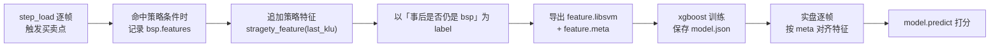

# 10 · 增量计算与策略开发

框架核心能力：在已有结果上**逐根喂 K 线**，每次只重算尾部不确定部分，返回「当下这一帧」的完整结构。本篇讲三种推进方式、多级别喂数、快照、信号消失、防未来函数，以及 demo 的完整流程。

源码：

- [Chan.py#L120-L151](file:///workspace/Chan.py#L120-L151)（`step_load` / `trigger_load`）
- [Chan.py#L238-L271](file:///workspace/Chan.py#L238-L271)（多级别递归）
- [Chan.py#L55-L83](file:///workspace/Chan.py#L55-L83)（`__deepcopy__`）
- [Chan.py#L313-L379](file:///workspace/Chan.py#L313-L379)（pickle）
- [Debug/strategy_demo.py](file:///workspace/Debug/strategy_demo.py)、[demo2](file:///workspace/Debug/strategy_demo2.py)、[demo3](file:///workspace/Debug/strategy_demo3.py)、[demo4](file:///workspace/Debug/strategy_demo4.py)、[demo5](file:///workspace/Debug/strategy_demo5.py)、[demo6](file:///workspace/Debug/strategy_demo6.py)

---

## 1. 三种推进方式

| 方式 | 开关 | 数据来源 | 典型用途 |
| --- | --- | --- | --- |
| 一次性静态计算 | `trigger_step=False` | `DataAPI` | 离线分析、选股 |
| 回放 `step_load()` | `trigger_step=True` | `DataAPI` | 回测、动画 |
| 外部投喂 `trigger_load()` | 两种都可用 | 调用方 | 实盘、合成 K 线、补当天数据 |

### 1.1 `step_load()`

[Chan.py#L120-L130](file:///workspace/Chan.py#L120-L130)：

```python
def step_load(self):
    assert self.conf.trigger_step
    self.do_init()                            # 清空，防止重复跑
    yielded = False
    for idx, snapshot in enumerate(self.load(self.conf.trigger_step)):
        if idx < self.conf.skip_step:
            continue
        yield snapshot
        yielded = True
    if not yielded:
        yield self
```

要点：

- `trigger_step=True` 时构造**不会**调用 `load()`（[Chan.py#L51-L53](file:///workspace/Chan.py#L51-L53)），必须显式 `step_load()`；
- 每次 yield 的是**同一个 `CChan` 对象**，要留存每帧结果必须 `copy.deepcopy(chan)`；
- `skip_step` 只影响返回，不影响内部计算。

### 1.2 `trigger_load(inp)`

[Chan.py#L132-L151](file:///workspace/Chan.py#L132-L151)：

```python
chan.trigger_load({KL_TYPE.K_DAY: [klu1, klu2], KL_TYPE.K_30M: [klu...]})
```

| 规则 | 说明 |
| --- | --- |
| 入参 | `Dict[KL_TYPE, List[CKLine_Unit]]` |
| 最高级别必填 | 缺少 `lv_list[0]` 抛 `CChanException(NO_DATA)` |
| 次级别可缺省 | 缺省级别本次不喂数据 |
| 缓存 | `klu_cache` 保存「超过当前父 K 线时间」的次级别 K 线，父级别推进后继续消费 |
| 时间校验 | 每根必须严格大于上一根（`KL_NOT_MONOTONOUS`） |
| 计算时机 | `trigger_step=True`：每根 klu 触发 `update_bi` → `cal_seg_and_zs`；`False`：全部喂完后统一 `cal_seg_and_zs` |

> 反复用 `trigger_load` 喂**同一批历史数据**是错误用法：只追加、不去重。重跑请新建 `CChan` 或从快照恢复。

### 1.3 重算范围

增量不重算全量，靠各模块的「安全位置」游标：

| 模块 | 游标 | 行为 |
| --- | --- | --- |
| 线段 | `last_sure_seg_start_bi_idx` | 从最后确定线段起点之后重算（`cal_seg`） |
| 中枢 | `last_sure_pos` / `last_seg_idx` | 弹掉不安全中枢后重算 |
| 买卖点 | `last_sure_pos` / `last_sure_seg_idx` | 删除尾部买卖点后重算 |
| 笔 | 虚笔 `sure_end` | 每次先撤虚笔再推进 |
| 线段内中枢 | `ele_inside_is_sure` | 连续 3 个确定段后固化，不再重算 |

性能与「尾部长度」相关，与总长度无关。

---

## 2. 从外部喂 K 线（实盘基础）

`Debug/strategy_demo2.py` 的最小骨架：

```python
config = CChanConfig({"trigger_step": True, "divergence_rate": 0.8, "min_zs_cnt": 1})
chan = CChan(code="sz.000001", data_src=DATA_SRC.BAO_STOCK,
             lv_list=[KL_TYPE.K_DAY], config=config)   # 此时不计算

CBaoStock.do_init()
src = CBaoStock("sz.000001", k_type=KL_TYPE.K_DAY, begin_date="2021-01-01",
                end_date=None, autype=AUTYPE.QFQ)

for klu in src.get_kl_data():
    chan.trigger_load({KL_TYPE.K_DAY: [klu]})
    bsp_list = chan.get_latest_bsp()
    # ... 策略 ...
CBaoStock.do_close()
```

策略读取数据的常用姿势：

```python
cur_lv = chan[0]
last_klc = cur_lv[-1]           # 最后一根合并K线
last_klu = last_klc[-1]         # 最后一根原始K线
prev_klc = cur_lv[-2]           # 倒数第二根（分型已确认）

last_bsp = chan.get_latest_bsp(number=1)[0]
if last_bsp.klu.klc.idx == prev_klc.idx:
    ...
```

> 为什么判断 `prev_klc` 而不是 `last_klc`？分型需要右侧一根确认（见 [02](02-K线与合并.md#44-分型判定-update_fx)），最新一根上的结构还不稳定。

---

## 3. 多级别喂数

### 3.1 一次性喂完次级别（推荐）

`Debug/strategy_demo4.py` 的技巧：

```python
kl_30m_all = list(data_src_30m.get_kl_data())
for idx, klu_day in enumerate(data_src_day.get_kl_data()):
    if idx == 0:
        chan.trigger_load({KL_TYPE.K_DAY: [klu_day], KL_TYPE.K_30M: kl_30m_all})
    else:
        chan.trigger_load({KL_TYPE.K_DAY: [klu_day]})
```

原理：`klu_cache` 会把「时间超过当前日线」的 30 分钟线缓存，等日线推进时消费。调用方**不需要自己做时间对齐**。

### 3.2 小级别驱动大级别（合成 K 线）

`Debug/strategy_demo3.py` 场景：实盘只有 15 分钟线，60 分钟线要自己合成，而「当前这根 60 分钟线」下一分钟会变化，框架无法回退已喂入的 K 线。

方案：**快照 + 重放**

```python
chan_snapshot = CChan(...)          # 上一个「所有级别都已确定」的时刻
klu_15m_lst_tmp = []

for klu_15m in src_15m.get_kl_data():
    klu_15m_lst_tmp.append(klu_15m)
    klu_60m = combine_60m_klu_form_15m(klu_15m_lst_tmp)

    chan = copy.deepcopy(chan_snapshot)
    chan.trigger_load({KL_TYPE.K_60M: [klu_60m],
                       KL_TYPE.K_15M: klu_15m_lst_tmp})
    # ... 策略 ...

    if len(klu_15m_lst_tmp) == 4:        # 60M 已完成，不再变化
        chan_snapshot = chan
        klu_15m_lst_tmp = []
```

代价是每根小级别 K 线都要深拷贝，性能开销大；完整版用 pickle 落盘快照降低内存。

---

## 4. `is_sure`、当前帧与信号消失

- 每次返回的都是**当前帧**结构，尾部元素可能 `is_sure=False`；
- 一类买卖点可能在多个 K 线位置「轮流出现」，最终只保留一个；
- 已确认元素不会回改，`is_sure=False` 只可能出现在头尾；
- **走势多义性**：任一时刻只能给出一种结构，有些「事后成立」的买卖点过程中可能一次都没被标记。quick_guide 建议的缓解办法是「每根 K 线用两组不同参数各跑一次」。

策略层义务：**自己判断当前买卖点是否值得交易**（背驰度、中枢数、成交量、模型打分……），框架只给结构。

---

## 5. 快照：deepcopy 与 pickle

### 5.1 `copy.deepcopy(chan)`

`CChan.__deepcopy__`（[Chan.py#L55-L83](file:///workspace/Chan.py#L55-L83)）流程：

1. 逐级别深拷贝 `CKLine_List`（内部再深拷贝 `CKLine/klu/bi/seg/segseg/zs/bsp/指标模型`）；
2. 重建跨级别引用：`memo[id(klu)].sup_kl = memo[id(klu.sup_kl)]`，`sub_kl_list` 同理；
3. 若存在 `klu_cache` / `klu_last_t`，一并深拷贝。

注意：

- `CKLine_Unit.__deepcopy__` **故意不拷贝** `klc/sup_kl/sub_kl_list/pre/next`，避免图结构递归爆炸；
- 不要单独深拷贝某个 klu 期望得到完整关系，必须整体深拷贝 `CChan`；
- 开销与总 K 线数成正比，不适合每帧都做（demo3 仅演示）。

### 5.2 pickle

```python
chan.chan_dump_pickle("chan.pkl")
chan2 = CChan.chan_load_pickle("chan.pkl")
```

实现（[Chan.py#L313-L379](file:///workspace/Chan.py#L313-L379)）：

- `chan_dump_pickle`：
  1. 临时把递归上限提高到 `0x100000`；
  2. 把所有 `klu/klc/bi/seg/segseg` 的 `pre/next` 置空（避免循环引用递归溢出）；
  3. `pickle.dump(self)`；
  4. 恢复递归上限并 `chan_pickle_restore()` 重建当前对象的关系链。
- `chan_load_pickle`：`pickle.load` 后对新对象 `chan_pickle_restore()`。

`chan_pickle_restore` 按列表顺序重建双向链表（klu、klc、bi、seg、segseg 五类），因此**不要手工打乱 `lst` 顺序**。

> 小缺陷：`chan_dump_pickle` 没有 `try/finally`，若 `pickle.dump` 抛异常，当前对象 `pre/next` 会保持被置空。生产代码建议先深拷贝再 dump，或自己包一层。

遇到 `RecursionError`，也可全局 `sys.setrecursionlimit(0x100000)`。

---

## 6. 两种模式的一致性

quick_guide 的承诺（也是设计目标）：

> 给定同样范围的 K 线，**静态一次性计算**与**逐根增量计算**的最终状态应当完全一致；不一致即为 bug。

实现上通过「每次推进先撤虚笔/回滚不安全尾部，再重算」保证。验证方式：

```python
c1 = CChan(code="...", config=CChanConfig({}), lv_list=[KL_TYPE.K_DAY], ...)

c2 = CChan(code="...", config=CChanConfig({"trigger_step": True}),
           lv_list=[KL_TYPE.K_DAY], ...)
for _ in c2.step_load():
    pass

assert len(c1[0].bi_list) == len(c2[0].bi_list)
assert len(c1[0].seg_list) == len(c2[0].seg_list)
assert len(c1[0].zs_list) == len(c2[0].zs_list)
```

> `step_load()` 是生成器，必须消费完（`for _ in ...: pass`）才会跑完整个数据集。

---

## 7. 防未来函数

- `trigger_load` 每次只交「当前时刻已有」的 K 线，框架内部**不会**访问未来数据；
- 只要在下一次 `trigger_load` 前完成判断，就不存在未来信息；
- 反例：
  - 先一次性喂完全部 K 线，再回头「逐帧」调用策略；
  - 用静态模式算完整个区间，把 `get_latest_bsp(number=0)` 全量列表当作「当时可知」的信号；
  - 访问可能由后续 K 线才确定的对象却不检查 `is_sure`。

检查清单：

1. 每帧只读当前帧对象；
2. 只对 `is_sure=True` 或「刚确认一根」的元素做决策；
3. 模型特征在离线/在线两条路径上保持一致。

---

## 8. 机器学习 demo 全链路

`strategy_demo5.py`（训练）与 `strategy_demo6.py`（预测）：



| 步骤 | 位置 |
| --- | --- |
| 记录特征（只在分型确认那根触发） | [demo5#L100-L109](file:///workspace/Debug/strategy_demo5.py#L100-L109) |
| 生成 label（用最终 bsp 列表反查） | [#L112-L118](file:///workspace/Debug/strategy_demo5.py#L112-L118) |
| 导出 libsvm + meta | [#L117-L133](file:///workspace/Debug/strategy_demo5.py#L117-L133) |
| 训练与保存 | [#L139-L150](file:///workspace/Debug/strategy_demo5.py#L139-L150) |
| 在线侧按 meta 对齐并预测 | [demo6 predict_bsp](file:///workspace/Debug/strategy_demo6.py#L21-L29) |

demo 里训练与预测使用同一份数据（作者已注明「不合理，仅为演示」）。真实使用需划分训练/验证集，并保证 `feature.meta` 索引顺序离线与在线一致。

---

## 9. 可用的策略骨架

```python
from Chan import CChan
from ChanConfig import CChanConfig
from Common.CEnum import AUTYPE, BSP_TYPE, DATA_SRC, FX_TYPE, KL_TYPE
from DataAPI.MyAPI import CMyApi

config = CChanConfig({
    "trigger_step": True,
    "divergence_rate": 0.8,
    "min_zs_cnt": 1,
    "bs_type": "1,2,3a",
    "print_warning": False,
})

chan = CChan(code="sz.000001", data_src="custom:MyAPI.CMyApi",
             lv_list=[KL_TYPE.K_DAY], config=config, autype=AUTYPE.QFQ)

CMyApi.do_init()
try:
    for klu in CMyApi(...).get_kl_data():
        chan.trigger_load({KL_TYPE.K_DAY: [klu]})

        cur = chan[0]
        if len(cur) < 3:
            continue

        bsps = chan.get_latest_bsp(number=1)
        if not bsps:
            continue
        bsp = bsps[0]

        if bsp.klu.klc.idx != cur[-2].idx:          # 必须是刚确认的分型
            continue
        if BSP_TYPE.T1 not in bsp.type and BSP_TYPE.T1P not in bsp.type:
            continue
        if bsp.features["divergence_rate"] > 0.8:     # 背驰度过滤
            continue
        if bsp.is_buy and cur[-2].fx != FX_TYPE.BOTTOM:
            continue
        if (not bsp.is_buy) and cur[-2].fx != FX_TYPE.TOP:
            continue

        price = cur[-1][-1].close
        # do_trade(bsp, price)
finally:
    CMyApi.do_close()
```

---

## 10. 性能注意事项

| 建议 | 原因 |
| --- | --- |
| 不要每帧 `deepcopy` | 开销与历史长度成正比；只在「必然不再变化」时快照 |
| 次级别一次性喂完 | 避免自己写对齐逻辑，减少调用次数 |
| 批量扫描关闭 `print_warning` | 大量股票会产生海量日志 |
| 不需要的指标不要开 | `cal_demark` / `cal_rsi` / `cal_kdj` / `mean_metrics` / `trend_metrics` 都有逐 K 线开销 |
| 不理解结构时不要关 `kl_data_check` | 关闭后时间错位不报错，但结果不可信 |
| 自定义指标沿用增量 + 缓存思路 | 热点取值用 `@make_cache`，改动后 `clean_cache()` |

---

## 11. 本篇小结

- 三种推进方式：静态、`step_load`、`trigger_load`；
- `step_load` 返回同一个对象，需要留存就深拷贝；
- 多级别喂数交给 `klu_cache` 对齐，不要自己切；
- 合成 K 线用「快照 + 重放」，不要试图修改已喂入的 K 线；
- 买卖点会消失，策略必须以当前帧 + `is_sure` 为准；
- pickle 会临时置空 `pre/next`，注意异常路径。

下一步：[11-应用示例与运行指南](11-应用示例与运行指南.md)。
