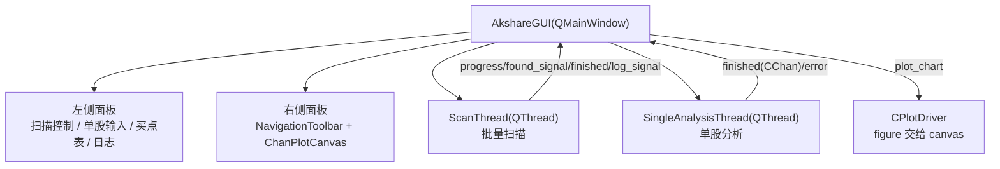

# 11 · 应用示例与运行指南

本篇覆盖：环境安装、`main.py` 逐段解读、6 个 `Debug` demo、`App` GUI，以及常见报错排查。

---

## 1. 环境与安装

### 1.1 版本要求

- **Python ≥ 3.11**（作者要求；本项目为计算密集型，3.11 相比 3.8 实测提速约 16%）。

验证环境（本次文档撰写时实际执行）：

```bash
$ python3 -V
Python 3.14.8
$ python3 -c "from Chan import CChan; print('ok')"
ok
```

> Python 3.14 下核心计算与 matplotlib 绘图均可运行；但依赖库（如 `baostock`）对新版本 Python 的 wheel 支持可能滞后，生产环境建议 3.11/3.12。

### 1.2 基础依赖

```bash
python3 -m venv .venv
source .venv/bin/activate
pip install -r Script/requirements.txt
```

内容（[Script/requirements.txt](file:///workspace/Script/requirements.txt)）：

```
baostock>=0.8.8
ipython>=8.5.0
matplotlib>=3.5.3
numpy>=1.23.3
pandas>=1.4.2
requests>=2.22.0
```

### 1.3 可选依赖

| 依赖 | 何时需要 | 安装 |
| --- | --- | --- |
| `akshare` | `DATA_SRC.AKSHARE`、`App` GUI | `pip install akshare` |
| `ccxt` | `DATA_SRC.CCXT` | `pip install ccxt` |
| `PyQt6` | `App/ashare_bsp_scanner_gui.py` | `pip install PyQt6` |
| `xgboost` | `Debug/strategy_demo5.py` / `demo6.py` | `pip install xgboost` |

> `Script/requirements.txt` 只列了基础依赖，上面这些都不会被自动安装。

### 1.4 无法联网 / 没有行情源时

核心计算不依赖具体数据源。可以用两种方式离线验证：

1. `DATA_SRC.CSV`：把 `{code}_{级别小写}.csv` 放到仓库根目录（列：`time,open,high,low,close`）；
2. 直接用 `trigger_load` 喂合成的 `CKLine_Unit`（见第 4 节）。

---

## 2. `main.py` 逐段解读

源码：[main.py](file:///workspace/main.py)

```python
code = "sz.000001"
begin_time = "2018-01-01"
end_time = None
data_src = DATA_SRC.BAO_STOCK
lv_list = [KL_TYPE.K_DAY]
```

- `end_time=None` 表示「到最新」；
- `lv_list` 必须**从大级别到小级别**，否则 `check_kltype_order` 断言失败。

配置：

```python
config = CChanConfig({
    "bi_strict": True,
    "trigger_step": False,
    "skip_step": 0,
    "divergence_rate": float("inf"),   # 不做背驰过滤 = 所有一类买卖点都算目标
    "bsp2_follow_1": False,            # 二类不要求跟在一类后
    "bsp3_follow_1": False,            # 三类不要求跟在一类后
    "min_zs_cnt": 0,                   # 不限中枢数
    "bs1_peak": False,                 # 一类不要求在中枢极值
    "macd_algo": "peak",
    "bs_type": '1,2,3a,1p,2s,3b',
    "print_warning": True,
    "zs_algo": "normal",
})
```

注意这是**演示用宽松配置**：不做背驰/中枢数量过滤，因此会画出大量买卖点。生产使用请参考 [07-配置体系](07-配置体系.md#5-推荐配置模板)。

绘图配置：

```python
plot_config = {"plot_kline": True, "plot_kline_combine": True, "plot_bi": True,
               "plot_seg": True, "plot_zs": True, "plot_bsp": True, ...}
plot_para = {"figure": {"x_range": 200}}
```

计算 + 绘图：

```python
chan = CChan(code=..., data_src=..., lv_list=..., config=..., autype=AUTYPE.QFQ)

if not config.trigger_step:
    driver = CPlotDriver(chan, plot_config=plot_config, plot_para=plot_para)
    driver.figure.show()
    driver.save2img("./test.png")
else:
    CAnimateDriver(chan, plot_config=plot_config, plot_para=plot_para)
```

运行：

```bash
python3 main.py          # 需要 baostock 且能联网
```

产物：当前目录生成 `test.png`，并弹出交互窗口（无显示环境请改用 `Agg` 后端，见第 5 节）。

---

## 3. `Debug` demo 索引

| 文件 | 主题 | 关键 API | 是否可直接运行 |
| --- | --- | --- | --- |
| [strategy_demo.py](file:///workspace/Debug/strategy_demo.py) | 基于 `step_load` 的回测（一类买卖点） | `step_load()`、`get_latest_bsp()` | ✅（需 baostock） |
| [strategy_demo2.py](file:///workspace/Debug/strategy_demo2.py) | 从外部逐根喂 K 线 | `trigger_load()` | ✅ |
| [strategy_demo3.py](file:///workspace/Debug/strategy_demo3.py) | 小级别合成大级别 + 快照重算 | `copy.deepcopy`、`trigger_load` | ⚠️ 仅演示（代码内注明不能直接跑） |
| [strategy_demo4.py](file:///workspace/Debug/strategy_demo4.py) | 多级别喂数时的自动时间对齐 | `trigger_load({DAY:[...], 30M:[全部]})` | ✅ |
| [strategy_demo5.py](file:///workspace/Debug/strategy_demo5.py) | 买卖点特征 → libsvm → XGBoost 训练 | `CFeatures`、`xgb` | ✅（需 xgboost） |
| [strategy_demo6.py](file:///workspace/Debug/strategy_demo6.py) | 实盘侧加载模型并打分 | `predict_bsp` | ✅（依赖 demo5 产物） |

### 3.1 demo1：最小回测逻辑

核心是「一类买卖点 + 底/顶分型确认」：

```python
for chan_snapshot in chan.step_load():
    bsp_list = chan_snapshot.get_latest_bsp()
    if not bsp_list:
        continue
    last_bsp = bsp_list[0]
    if BSP_TYPE.T1 not in last_bsp.type and BSP_TYPE.T1P not in last_bsp.type:
        continue
    cur_lv_chan = chan_snapshot[0]
    if last_bsp.klu.klc.idx != cur_lv_chan[-2].idx:   # 必须是刚确认的分型
        continue
    if cur_lv_chan[-2].fx == FX_TYPE.BOTTOM and last_bsp.is_buy:
        ...  # 开仓
    elif cur_lv_chan[-2].fx == FX_TYPE.TOP and not last_bsp.is_buy:
        ...  # 平仓
```

这个「`klu.klc.idx == cur[-2].idx`」判断是所有策略 demo 的公共套路，用来避免在结构尚未确认时交易。

### 3.2 demo3：为什么需要快照

实盘合成 K 线时，「当前这根大级别 K 线」会随小级别数据变化，而 `trigger_load` 只能追加、不能回退。demo3 的方案：

```python
chan = copy.deepcopy(chan_snapshot)                 # 回到上一个确定状态
chan.trigger_load({KL_TYPE.K_60M: [klu_60m],
                   KL_TYPE.K_15M: klu_15m_lst_tmp})  # 重新喂到当前
if 60M 已完成: chan_snapshot = chan                   # 固化
```

### 3.3 demo5 / demo6：机器学习链路

- demo5 用 `last_bsp.features` 收集特征，以「该买卖点最终是否仍存在」为 label，导出 `feature.libsvm` + `feature.meta`，训练 XGBoost 并存成 `model.json`；
- demo6 加载 `model.json` + `feature.meta`，在实盘逐帧按 meta 的索引对齐特征并 `predict`。

两者必须在**同一个工作目录**下依次运行（demo6 直接读 demo5 产出的文件）。

---

## 4. 无数据源的最小冒烟测试

下面这段不依赖任何行情库，用合成数据验证「合并 → 笔 → 段 → 中枢 → 买卖点 → 绘图 → 序列化」整条链路（本次文档撰写时已实际跑通）：

```python
import datetime, random, sys
import matplotlib
matplotlib.use("Agg")           # 无显示环境

from Chan import CChan
from ChanConfig import CChanConfig
from Common.CEnum import AUTYPE, DATA_FIELD, KL_TYPE
from Common.CTime import CTime
from KLine.KLine_Unit import CKLine_Unit
from Plot.PlotDriver import CPlotDriver

chan = CChan(code="test", data_src="custom:csvAPI.CSV_API",
             lv_list=[KL_TYPE.K_DAY],
             config=CChanConfig({"trigger_step": True}), autype=AUTYPE.QFQ)

random.seed(7)
price = 10.0
for i in range(300):
    o = price
    c = max(1.0, o * (1 + random.uniform(-0.03, 0.032)))
    h = max(o, c) * (1 + random.uniform(0, 0.01))
    l = min(o, c) * (1 - random.uniform(0, 0.01))
    d = datetime.date(2020, 1, 1) + datetime.timedelta(days=i)
    klu = CKLine_Unit({
        DATA_FIELD.FIELD_TIME: CTime(d.year, d.month, d.day, 0, 0),
        DATA_FIELD.FIELD_OPEN: o, DATA_FIELD.FIELD_CLOSE: c,
        DATA_FIELD.FIELD_HIGH: h, DATA_FIELD.FIELD_LOW: l,
        DATA_FIELD.FIELD_VOLUME: 1000.0,
    })
    chan.trigger_load({KL_TYPE.K_DAY: [klu]})
    price = c

kl = chan[0]
print("KLC", len(kl), "BI", len(kl.bi_list), "SEG", len(kl.seg_list),
      "ZS", len(kl.zs_list), "BSP", len(kl.bs_point_lst))

CPlotDriver(chan, plot_config={"plot_kline": True, "plot_bi": True,
                               "plot_seg": True, "plot_zs": True,
                               "plot_bsp": True}).save2img("smoke.png")

chan.chan_dump_pickle("smoke.pkl")
print("reload BI", len(CChan.chan_load_pickle("smoke.pkl")[0].bi_list))
```

期望输出（参考值，具体数字取决于随机序列）：

```
KLC 222 BI 14 SEG 3 ZS 2 BSP 2
reload BI 14
```

> 这段代码也是排查环境问题的好工具：如果它跑不通，说明问题在 Python/matplotlib/项目路径，而不是行情源。

---

## 5. `App/ashare_bsp_scanner_gui.py`（PyQt6 GUI）

### 5.1 功能

- **批量扫描**：拉取全 A 股实时列表，逐只做日线缠论分析，找出最近 3 天内出现买点的股票；
- **单股分析**：输入代码后单独分析并画图；
- **图表展示**：K 线、笔、线段、中枢、MACD、买卖点，支持 matplotlib 工具栏缩放/平移。

### 5.2 结构



| 类 | 行 | 职责 |
| --- | --- | --- |
| `get_tradable_stocks()` | [L54](file:///workspace/App/ashare_bsp_scanner_gui.py#L54-L102) | `ak.stock_zh_a_spot_em()` + 过滤 |
| `ScanThread` | [L105](file:///workspace/App/ashare_bsp_scanner_gui.py#L105-L221) | 遍历股票列表，逐只 `CChan` 分析，`found_signal` 上报买点 |
| `SingleAnalysisThread` | [L224](file:///workspace/App/ashare_bsp_scanner_gui.py#L224-L268) | 单只股票分析，返回 `CChan` |
| `ChanPlotCanvas` | [L271](file:///workspace/App/ashare_bsp_scanner_gui.py#L271-L292) | matplotlib 画布嵌入 |
| `AkshareGUI` | [L295](file:///workspace/App/ashare_bsp_scanner_gui.py#L295-L728) | 主窗口、事件绑定、绘图 |

### 5.3 过滤规则与判定

`get_tradable_stocks` 依次剔除：

1. 名称含 `ST`；
2. 科创板 `688`；
3. 北交所 `8` / `43` 开头；
4. B 股 `200` / `900`；
5. CDR `920`；
6. 成交量为 0（停牌）；
7. 最新价 ≤ 0。

扫描时：

- 数据窗口：最近 **365 天**、日线、`DATA_SRC.AKSHARE`；
- 跳过无 K 线数据、以及最后一根 K 线距今超过 **15 天**（疑似停牌）的股票；
- 用 `chan.get_latest_bsp(number=0)` 取全部买卖点，筛出 **买点且时间在最近 3 天内**。

GUI 使用的缠论配置（[get_chan_config](file:///workspace/App/ashare_bsp_scanner_gui.py#L510-L530)）与 `main.py` 基本一致，但关闭了日志：`divergence_rate=inf`、`min_zs_cnt=0`、`bs1_peak=False`、`bsp2/3_follow_1=False` —— 这是一个「尽量多出信号」的宽松配置，扫描结果需要二次判断。

### 5.4 运行

```bash
pip install PyQt6 akshare
python App/ashare_bsp_scanner_gui.py
```

脚本开头会把项目根目录插入 `sys.path`（[L25-L29](file:///workspace/App/ashare_bsp_scanner_gui.py#L25-L29)），所以可以在任意工作目录启动。

注意事项：

- GUI 强制使用 `DATA_SRC.AKSHARE`，必须安装 `akshare` 且能访问东方财富接口；
- 批量扫描是**串行**的（一只一只算），全市场需要较长时间；`ScanThread.stop()` 只是置标志位，当前这只股票算完才退出；
- `stock_cache` 缓存已分析结果，切换股票时不重复计算；
- 绘图用 `plt.close('all')` 释放旧图，但窗口内只保留最新一张图。

---

## 6. 常见报错与处理

| 报错 / 现象 | 根因 | 处理 |
| --- | --- | --- |
| `ModuleNotFoundError: baostock` | 未安装基础依赖 | `pip install -r Script/requirements.txt` |
| `ModuleNotFoundError: akshare` / `PyQt6` / `xgboost` / `ccxt` | 可选依赖未装 | 见 1.3 节 |
| 运行完窗口一闪而过 | matplotlib 交互窗口在程序结束时关闭 | Jupyter 中运行 / `save2img` 先落盘 / 末尾加 `input()` |
| `kline time err, cur=..., last=...` | 时间非严格递增，或分钟级 0:00 被当成日线 | 数据源里保证升序；分钟级 `CTime(..., auto=False)`（[08](08-数据接入与指标.md#32-必须遵守的-5-条约定)） |
| `low price=... is not min` / `high price=... is not max` | 数据源高低价异常 | 修正数据，或 `CKLine_Unit(..., autofix=True)` |
| `在次级别找不到K线条数超过...` | 次级别数据缺失 | 补数据；`max_kl_misalgin_cnt`；或对指数用 `auto_skip_illegal_sub_lv` |
| `父&子级别K线时间不一致条数超过...` | 父级别缺数据 | 补齐父级别；调整 `max_kl_inconsistent_cnt` |
| `最高级别没有获得任何数据` | 代码格式 / 日期范围 / 数据源无数据 | 检查 `code` 格式与 `begin_time` |
| `RecursionError`（deepcopy / pickle） | `pre/next` 形成环 | 用 `chan_dump_pickle` / `chan_load_pickle`，或 `sys.setrecursionlimit(0x100000)` |
| 线段看起来不对 | 特征序列分型未确认 / 参数不符预期 | 打开 `plot_eigen` 观察；确认 `seg_algo` 与 `left_seg_method` |
| 买卖点会「消失」 | 当前帧结构被后续 K 线修正 | 预期行为，见 [10](10-增量计算与策略开发.md#4-is_sure当前帧与信号消失) |
| `unknown para = xxx` | 传了完整版参数（`cbsp_strategy`/`model`/`only_judge_last`/`od_*` 等） | 本仓库不支持，删掉该参数 |
| `plot_cbsp` 没有效果 | 本仓库未实现 cbsp | 用 `plot_bsp` / `plot_segbsp` |
| 动画越来越卡 / 内存暴涨 | `CAnimateDriver` 已知内存泄漏 | 仅作演示，帧数多时改用自己保存图片 |

---

## 7. 本篇小结

- 基础依赖只够跑核心 + matplotlib；akshare/ccxt/PyQt6/xgboost 需单独装；
- `main.py` 是宽松演示配置，生产请收紧背驰与中枢门槛；
- 6 个 demo 分别覆盖：回测、外部喂数、快照重算、多级别对齐、特征训练、在线预测；
- GUI 是「扫描器」示例，串行扫描、宽松配置，适合作为二次开发起点；
- 遇到环境问题，先跑第 4 节的合成数据冒烟测试定位边界。

下一步：[12-扩展开发与依赖关系](12-扩展开发与依赖关系.md)。
