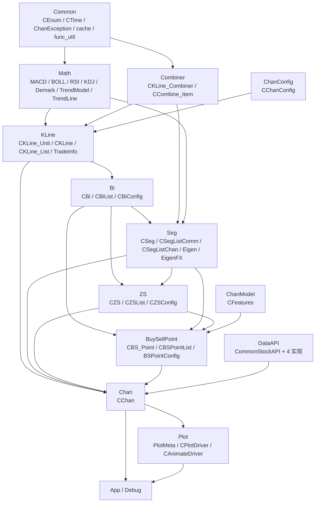

# 12 · 扩展开发与依赖关系

本篇给出完整的模块依赖视图、六类扩展点的落地方式、性能建议，以及阅读/改造时需要知道的实现细节与坑。

---

## 1. 完整依赖图



### 1.1 直接 import 关系（可核对）

| 文件 | 直接 import（项目内） |
| --- | --- |
| `Common/*` | 仅互相引用（`func_util → CEnum`） |
| `Math/*` | `Common.CEnum`、`Common.ChanException` |
| `Combiner/Combine_Item.py` | `Common.ChanException`；`CBi/CSeg/CKLine_Unit` **在方法内** import |
| `Combiner/KLine_Combiner.py` | `Common.cache/CEnum/ChanException`、`KLine.KLine_Unit` |
| `KLine/KLine_Unit.py` | `Common.*`、`Math.*`、`TradeInfo`；`KLine.KLine` **在方法内** import |
| `KLine/KLine.py` | `Combiner.KLine_Combiner`、`Common.*`、`KLine_Unit` |
| `KLine/KLine_List.py` | `Bi.*`、`BuySellPoint.*`、`ChanConfig`、`Seg.*`、`ZS.*` |
| `Bi/Bi.py` | `Common.*`、`KLine.*`；`CSeg/CBS_Point` **在方法内** import |
| `Bi/BiList.py` | `Common.*`、`KLine.KLine` |
| `Seg/Seg.py` | `Bi.Bi`、`Math.TrendLine`、`EigenFX`；`CZS/CBS_Point` **在方法内** |
| `Seg/SegListComm.py` | `Bi.*`、`Seg`、`SegConfig` |
| `Seg/SegListChan.py` | `Bi.BiList`、`EigenFX`、`SegListComm` |
| `Seg/EigenFX.py` | `Bi.*`、`Common.*`、`Eigen` |
| `ZS/ZS.py` | `Bi.Bi`、`BuySellPoint.BSPointConfig`、`Seg.Seg`、`Common.*` |
| `ZS/ZSList.py` | `Bi.*`、`Seg.*`、`ZS` |
| `BuySellPoint/BS_Point.py` | `Bi.Bi`、`ChanModel.Features`、`Seg.Seg` |
| `BuySellPoint/BSPointList.py` | `Bi.*`、`Seg.*`、`ZS.ZS`、`BS_Point`、`BSPointConfig` |
| `ChanConfig.py` | 各子配置 + `Math.*` |
| `Chan.py` | `BuySellPoint.BS_Point`、`ChanConfig`、`Common.*`、`DataAPI.CommonStockAPI`、`KLine.*` |
| `Plot/PlotMeta.py` | `Bi`、`BuySellPoint`、`KLine`、`Seg`、`ZS` |
| `Plot/PlotDriver.py` | `Chan`、`Common.*`、`Math.Demark`、`PlotMeta` |

### 1.2 循环依赖的处理约定

四个「方法内 import」是刻意设计的断环点：

| 位置 | 环 | 断法 |
| --- | --- | --- |
| `CKLine_Unit.__init__` | `KLine_Unit → KLine → KLine_Combiner[CKLine_Unit]` | `from KLine.KLine import CKLine` 放进方法 |
| `CCombine_Item.__init__` | `Combiner → Bi/Seg/KLine → Combiner` | 三种元素类型在方法内 import |
| `CBi.__init__` | `Bi → Seg → Bi`、`Bi → BuySellPoint → Bi` | `CSeg`、`CBS_Point` 只用于类型标注 |
| `CSeg.__init__` | `Seg → ZS → Seg`、`Seg → BSP → Seg` | `CZS`、`CBS_Point` 方法内 import |
| `KLine_List.get_seglist_instance` | 工厂选择具体算法 | 运行时 import 子类 |

**扩展时请沿用这个约定**：如果你在 `Bi` 里需要引用 `Seg` 的新类，把 import 放进方法内，不要放到文件顶部。

---

## 2. 六类扩展点

### 2.1 数据源（最简单，推荐）

1. 在 `DataAPI/` 新建文件，继承 `CCommonStockApi`；
2. 实现 `get_kl_data()`（生成器）、`SetBasciInfo()`、`do_init()`、`do_close()`；
3. `CChan(data_src="custom:文件名.类名")`。

完整模板与 5 条数据约定见 [08-数据接入与指标](08-数据接入与指标.md#3-接入自己的数据源)。

### 2.2 指标

三步：`Math/` 写增量模型 → `CChanConfig.GetMetricModel()` 注册 → `CKLine_Unit.set_metric()` 写回。可选再加 `DrawElement` 分支。详见 [08](08-数据接入与指标.md#6-新增一个指标以-rsi-为模板)。

### 2.3 笔算法

现状：

- `CChanConfig` 只支持 `bi_algo = normal | fx`；
- `normal` 的完整逻辑在 `CBiList`，没有抽象基类。

想实现自己的画笔：

| 方案 | 做法 | 影响 |
| --- | --- | --- |
| 轻量 | 通过参数组合逼近（`bi_strict` / `bi_fx_check` / `gap_as_kl` / `bi_end_is_peak`） | 无需改代码 |
| 中等 | 在 `CBiList.can_make_bi` 里新增 `bi_algo` 分支 | 改动集中，但需要自己保证笔的方向/端点合法 |
| 彻底 | 复制 `CBiList` 为新类，在 `CKLine_List.__init__` 中按配置实例化（参考 `get_seglist_instance` 的工厂写法） | 需要实现 `update_bi / try_add_virtual_bi / delete_virtual_bi` 全套接口 |

无论哪种，都必须保证：`CBi` 的方向由起点分型决定、端点是区间极值、`is_sure` 语义与虚笔回滚一致。否则线段/中枢/买卖点会连锁出错。

### 2.4 线段算法（有现成扩展骨架）

`CSegListComm` 就是为扩展准备的模板方法基类：

```python
class CSegListMyAlgo(CSegListComm):
    def update(self, bi_lst: CBiList):
        self.do_init()                       # 清掉未确定段
        # 1) 计算确定线段：调用 self.add_new_seg(bi_lst, end_idx, is_sure=True, ...)
        # 2) 处理剩余笔：调用 self.collect_left_seg(bi_lst)
        ...
```

接入方式（二选一）：

- **改工厂**：在 [get_seglist_instance](file:///workspace/KLine/KLine_List.py#L19-L32) 增加分支；
- **改配置**：`CSegConfig.seg_algo` 增加取值并映射。

参考实现：`CSegListDYH`（1+1 终结）、`CSegListDef`（线段破坏定义）。注意这两个类在代码里被标记为 deprecated，但结构是最清晰的「非特征序列」示例。

### 2.5 买卖点

`CBSPointList` 把六类买卖点写死在 `cal()` 里，扩展方式：

1. **新增类型**：在 `BSP_TYPE` 加枚举 → 在 `CPointConfig.parse_target_type` 的白名单里加值 → 在 `CBSPointList.cal` 里加一个 `cal_seg_bsXpoint`；
2. **改判定条件**：直接改对应的 `treat_bspX` 函数（注意保持 `add_bs` 的 `is_target_bsp` 语义）；
3. **动力学买卖点（cbsp）**：本仓库不提供。若要做，建议**不要**改 `CBSPointList`，而是在外部基于 `trigger_load` + 自己的 `Strategy` 类产出信号（完整版就是这么做的），这样不会污染形态学结果。

无论怎么改，都要维护：

- `bsp_store_flat_dict` 的「一笔一个对象」去重；
- `clear_store_end` / `clear_bsp1_end` 的尾部回滚；
- `last_sure_pos` 的推进，否则增量计算会残留失效买卖点。

### 2.6 绘图

- **换引擎**：消费 `CChanPlotMeta`，不要继承 `CPlotDriver`；
- **加元素**：`plot_config` 加开关 → `DrawElement` 加分支 → 实现 `draw_xxx`，参数通过 `plot_para["xxx"]` 透传；
- **加标注**：优先用 `plot_marker`（无需改代码），它支持任意日期 + 文本 + 上下箭头。

---

## 3. 性能建议

### 3.1 已验证的优化点

| 机制 | 位置 | 说明 |
| --- | --- | --- |
| 增量指标 | 所有 `Math/*.add` | 只保留滑动窗口，不重算历史 |
| 单根写回 | `CKLine_Unit.set_metric` | 指标只算一次，全项目复用 `klu.macd` 等 |
| 实例级缓存 | `Common/cache.make_cache` | 笔/段的极值、振幅等高频取值 O(1) |
| 安全位置游标 | 线段/中枢/买卖点 | 只重算尾部不确定部分 |
| 尾部固化 | `CSeg.ele_inside_is_sure` | 连续 3 个确定段后不再重算段内中枢 |
| 数据校验开关 | `kl_data_check=False` | 省掉父子时间比对（**代价是失去数据质量保护**） |

### 3.2 使用侧优化

| 场景 | 建议 |
| --- | --- |
| 海量选股 | 只开必要指标（关 `cal_demark`/`cal_rsi`/`cal_kdj`，别配 `mean_metrics`），关 `print_warning` |
| 回测 | 用 `step_load()` 而不是自己反复 `trigger_load` 全量数据 |
| 实盘多级别 | 次级别一次性喂完，靠 `klu_cache` 对齐 |
| 快照 | 只在「所有级别都确定」时 `deepcopy` / pickle |
| 画图 | 生产批量出图用 `Agg` + `save2img`，不要 `figure.show()` |

### 3.3 自定义代码的性能要求

- 指标必须**增量**：`add(value)` 只依赖上一状态和当前值；
- 缓存装饰器 `@make_cache` 只能用于 `(self)` 无参方法；一旦对象可变，必须 `clean_cache()`；
- 避免在 `draw_*` 或策略里对每根 K 线做 O(n) 扫描（`CChanPlotMeta` 已预计算好数组）。

---

## 4. 实现细节与已知坑

阅读源码时容易踩的点，集中列出：

| # | 细节 | 影响 / 对策 |
| --- | --- | --- |
| 1 | `CTime` 只实现 `__gt__` / `__ge__`，没有 `__lt__` | 自己写比较时统一用 `t1 > t2` / `t1 >= t2` |
| 2 | `CTime(auto=True)` 把 0:00 解释为当天 23:59 | 分钟级 0:00 数据要 `auto=False` |
| 3 | `CChanConfig` 构造会**清空**传入字典 | 复用配置先 `dict(d)` / `deepcopy` |
| 4 | `CChanConfig` / `CPointConfig` 用 `exec` 赋值 | 不要把不可信外部输入直接塞进配置 |
| 5 | `CBiConfig()` 直接实例化的默认值与 `CChanConfig` 传入的不同 | 以 `CChanConfig` 为准 |
| 6 | `make_cache` 要求方法签名只有 `self` | 带参数的函数不能加该装饰器 |
| 7 | `CKLine_Combiner.pre` 在首元素上断言失败 | 访问前先判空或确认非首元素 |
| 8 | `CBiList/CZSList/CSegListComm` 用了**可变默认参数**（`CBiConfig()` 等） | 这些配置实际只读，风险低；但不要修改默认实例的字段 |
| 9 | `CSegListComm.update` 标了 `@abc.abstractmethod`，但类未继承 `ABC` | 基类可被实例化，`update` 返回 `None`，不要直接使用基类 |
| 10 | `CChan.get_bsp` 已废弃 | 用 `get_latest_bsp(idx, number)` |
| 11 | `plot_marker` 的箭头头部参数名是 `arrow_h_r` | 不是 README 的 `arrow_h` |
| 12 | `x_end_date`、`plot_cbsp`、`plot_tradeinfo`、`extra_kl`、`only_judge_last`、`model` 等只在 README 出现 | 本仓库未实现，不要依赖 |
| 13 | `chan_dump_pickle` 没有 `try/finally` | 异常时当前对象 `pre/next` 保持置空；先深拷贝再 dump 更安全 |
| 14 | `CChanPlotMeta` 的 `klu_len` 是原始 K 线总数，不是合并 K 线数 | 自定义绘图时注意 x 轴基准 |
| 15 | `plot_seg` 的 `sub_lv_cnt` 与 `plot_bi` 的 `sub_lv_cnt` 互斥 | 只能开一个 |
| 16 | 线段买卖点的 `macd_algo` 被强制改成 `slope` | 配 `peak` 无效 |

---

## 5. 改造前的自检清单

改动任何结构算法前，建议按下面顺序验证：

1. **合成数据冒烟**：用 [11-应用示例与运行指南](11-应用示例与运行指南.md#4-无数据源的最小冒烟测试) 的脚本确认全链路可跑；
2. **静态 vs 增量一致性**：同一份数据分别用 `trigger_step=False` 与 `step_load()` 跑完，比较 `bi/seg/zs/bsp` 数量（quick_guide 的设计承诺）；
3. **边界数据**：单根 K 线、两根 K 线、含一字线、含跳空、含停牌（长时间无数据）；
4. **多级别**：至少跑一次 `[K_DAY, K_30M]`，确认没有 `KL_DATA_NOT_ALIGN`；
5. **绘图核对**：打开 `plot_kline_combine / plot_bi / plot_seg / plot_zs / plot_bsp` 目视检查；
6. **序列化**：`chan_dump_pickle` → `chan_load_pickle` 后元素数量一致；
7. **性能回归**：改完后用 `cProfile`（可参考 README 提到的 `Debug/cprofile_analysis`，本仓库未包含该脚本）观察热点是否退化。

---

## 6. 模块索引（速查）

| 想找… | 去哪个文件 |
| --- | --- |
| 主流程 / 时间对齐 / 序列化 | [Chan.py](file:///workspace/Chan.py) |
| 全部配置项 | [ChanConfig.py](file:///workspace/ChanConfig.py) |
| 枚举 / 错误码 | [Common/CEnum.py](file:///workspace/Common/CEnum.py)、[Common/ChanException.py](file:///workspace/Common/ChanException.py) |
| K 线时间 | [Common/CTime.py](file:///workspace/Common/CTime.py) |
| 缓存装饰器 | [Common/cache.py](file:///workspace/Common/cache.py) |
| 数据源接口 | [DataAPI/CommonStockAPI.py](file:///workspace/DataAPI/CommonStockAPI.py) |
| 合并规则 / 分型 | [Combiner/KLine_Combiner.py](file:///workspace/Combiner/KLine_Combiner.py)、[KLine/KLine.py](file:///workspace/KLine/KLine.py) |
| 级别总容器 | [KLine/KLine_List.py](file:///workspace/KLine/KLine_List.py) |
| 画笔状态机 | [Bi/BiList.py](file:///workspace/Bi/BiList.py) |
| 笔的力度 | [Bi/Bi.py](file:///workspace/Bi/Bi.py#L189-L332) |
| 划段 | [Seg/SegListChan.py](file:///workspace/Seg/SegListChan.py)、[Seg/EigenFX.py](file:///workspace/Seg/EigenFX.py) |
| 中枢 / 背驰 | [ZS/ZS.py](file:///workspace/ZS/ZS.py)、[ZS/ZSList.py](file:///workspace/ZS/ZSList.py) |
| 买卖点 | [BuySellPoint/BSPointList.py](file:///workspace/BuySellPoint/BSPointList.py) |
| 指标 | [Math/](file:///workspace/Math) |
| 特征容器 | [ChanModel/Features.py](file:///workspace/ChanModel/Features.py) |
| 绘图坐标 | [Plot/PlotMeta.py](file:///workspace/Plot/PlotMeta.py) |
| 绘图实现 | [Plot/PlotDriver.py](file:///workspace/Plot/PlotDriver.py) |

---

## 7. 本篇小结

- 依赖是严格单向的：`Common → Math/Combiner → KLine → Bi → Seg → ZS → BSP → Chan → Plot/App`；
- 循环依赖靠「方法内 import」打断，扩展时必须遵守；
- 数据源、指标、线段、绘图都有清晰的扩展骨架；笔与买卖点需要更小心地维护不变量；
- 性能来自「增量指标 + 实例缓存 + 尾部重算」，自定义代码要延续这些原则；
- 第 4 节的 16 个坑，是改造前最值得先看的部分。

返回 [CodeWiki 首页](README.md)。
